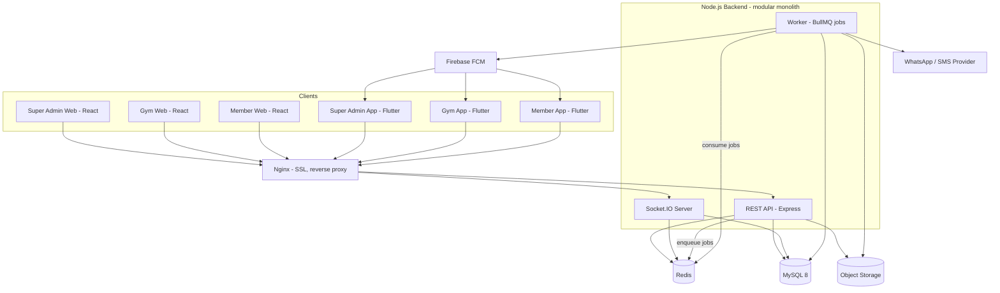
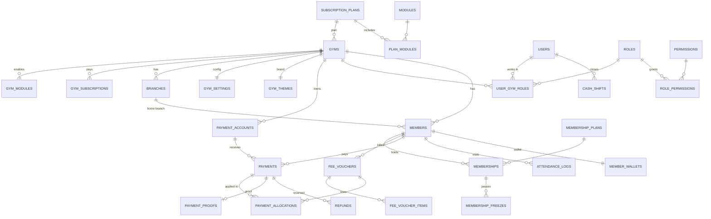
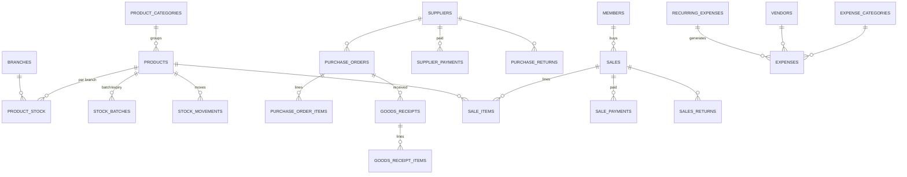
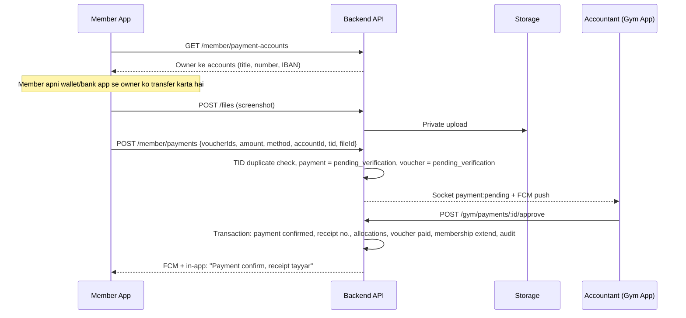

# Gym Management System (Pakistan) — Technical Document

Oct 17, 2026 · @Aman

## 0. Claude Pro ke liye Instructions (pehle yeh parhein)

Yeh document **Gym Management System (Pakistan)** ka technical blueprint hai. Isay hamesha **"Complete Feature Document"** ke saath parhein. Feature document batata hai *kya* banana hai; yeh document batata hai *kaise* banana hai. Dono `Gym-System/Doc/` folder mein hain.

### 0.1 Kaam ka tareeqa (order zaroori hai)

1. **Dono documents poore parhein:** Complete Feature Document aur yeh Technical Document.
2. **Project folder dekhein:** `Gym-System/` ke andar `Backend`, `Frontend`, `MobileApp`, `Doc`, `Database`.
3. **Section 13 ke sawal user se lazmi poochein.** Jab tak user jawab na de, code likhna shuru na karein. Jo sawal is document se already hal ho jaye woh na poochein; jo naya sawal samajh aaye woh add karein.
4. Jawab milne ke baad **Implementation Plan** banayein (section 12 ke format mein), aur user se approve karwayein.
5. Approval ke baad **phase-by-phase** code likhein. Har phase ke aakhir mein user ko batayein kya bana, kaise test karein, aur agla phase kya hai.
6. Agar implementation ke dauran is document aur feature document mein farq ho, ya koi cheez wazeh na ho, to **khud faisla na karein, user se poochein**.

### 0.2 Code ke lazmi rules

- **Har cheez alag file mein:** ek file = ek zimmedari (ek controller, ek service, ek widget, ek component, ek model). Bari files (300+ lines) ko tod dein.
- **Reusable pehle:** koi UI ya logic doosri dafa likhni pare to usay shared component/widget/helper banayein.
- **Hard-coded values nahi:** colors, sizes, strings, URLs, keys sab constants/theme/config/env se.
- **Production level:** validation, error handling, loading/empty/error states, logging, pagination, security har jagah.
- **Tenant safety:** har database query mein `gym_id` (aur jahan zaroori `branch_id`) ki shart; client se aaya `gym_id` kabhi trust na karein (section 3).
- **Permission check backend par:** frontend/mobile menu chhupana sirf UI ke liye hai; asal check API par hoga.
- **Naming aur style:** section 11 ke conventions.
- **Secrets git mein nahi:** `.env` files ignore; har project mein `.env.example`.
- **Har module ka structure same:** naya module purane module ki tarah hi bane (backend, frontend, mobile teeno mein).
- **Comments aur README:** har project ka README (setup, run, env, scripts); mushkil logic par chhota comment.

### 0.3 Is document ki zabaan

Document Roman Urdu mein hai, technical terms English mein. **Code, file names, database names, API routes aur comments English mein** honge. App ki UI Urdu + English dono mein (i18n).

### 0.4 Is document ki hadood

- Pakistan-only product: PKR, +92, Urdu/English, Asia/Karachi timezone.
- Har gym ka subdomain ya public landing page **nahi**.
- Library versions: implementation ke waqt ka **latest stable/LTS** use karein, aur `package.json` / `pubspec.yaml` mein version lock karein.

## 1. Project Overview, Tech Stack aur Folder Structure

Ek multi-gym SaaS bana rahe hain: **ek backend + ek MySQL database** sab gyms ke liye, aur upar **3 web portals** (React) aur **3 mobile apps** (Flutter). Har gym ka data `gym_id` se alag rehta hai.

### 1.1 Apps ki list

| # | App | Tech | Users |
| --- | --- | --- | --- |
| 1 | Super Admin Web | React | Platform owner aur team |
| 2 | Gym Web Portal | React | Gym owner, partner, manager, receptionist, accountant, store, trainers |
| 3 | Member Web Portal | React | Members |
| 4 | Super Admin App | Flutter | Platform owner aur team |
| 5 | Gym App (owner + staff) | Flutter | Gym ke saare staff roles |
| 6 | Member App | Flutter | Members |
| 7 | Backend API + Socket server + Worker | Node.js + Express | Sab apps ka backend |

### 1.2 Tech Stack (final)

**Backend**

| Kaam | Choice | Note |
| --- | --- | --- |
| Runtime | Node.js (LTS) |  |
| Framework | Express.js |  |
| Language | TypeScript (recommended) | Production mein type-safety; agar user plain JavaScript chahe to section 13 ka sawal |
| Database | MySQL 8 (InnoDB, utf8mb4) | Urdu text ke liye utf8mb4 lazmi |
| ORM / Migrations | Prisma (recommended) | Alternative: Sequelize/Knex — sawal 13 |
| Validation | Zod | Request body/query/params |
| Auth | JWT (access + refresh), bcrypt/argon2 | Section 3 |
| Realtime | Socket.IO + Redis adapter | Chat + live notifications |
| Cache / Queue | Redis + BullMQ | Jobs: vouchers, reminders, notifications, reports |
| Scheduler | BullMQ repeatable jobs (ya node-cron) |  |
| Push notifications | Firebase Admin SDK (FCM) | Mobile + web push |
| Files | S3-compatible object storage (recommended) ya local disk (dev) | Photos, slips, PDFs |
| PDF | PDFKit (ya Puppeteer HTML-to-PDF) | Receipts, vouchers, payslips |
| Excel | ExcelJS | Import/export |
| Logging | Pino (JSON logs) |  |
| Security | Helmet, CORS, express-rate-limit, hpp |  |
| API docs | OpenAPI/Swagger | `/api/docs` (sirf dev/staging) |
| Testing | Jest + Supertest |  |
| Process manager | PM2 (cluster) ya Docker |  |

**Frontend (Web)**

| Kaam | Choice |
| --- | --- |
| Framework | React + Vite + TypeScript |
| Routing | React Router |
| Server state | TanStack Query (React Query) |
| Client state | Zustand (auth, theme, UI state) |
| Forms | React Hook Form + Zod |
| UI | Tailwind CSS + shadcn/ui (Radix based) — apna reusable component library |
| Tables | TanStack Table |
| Charts | Recharts |
| i18n | i18next (Urdu RTL + English) |
| Realtime | socket.io-client |
| Push (web) | Firebase JS SDK (optional) |
| HTTP | Axios (interceptors) |
| Icons | lucide-react |
| Testing | Vitest + React Testing Library, Playwright (E2E) |
| Monorepo | pnpm workspaces |

**Mobile**

| Kaam | Choice |
| --- | --- |
| Framework | Flutter (stable) |
| State, routing, DI | GetX |
| HTTP | Dio (interceptors, refresh token) |
| Secure storage | flutter\_secure\_storage (tokens, sensitive data) |
| Local DB (offline) | Drift (SQLite) ya Isar — sawal 13 |
| Push | firebase\_messaging + flutter\_local\_notifications |
| Realtime | socket\_io\_client |
| QR scan / generate | mobile\_scanner, qr\_flutter |
| Images | image\_picker, cached\_network\_image |
| PDF / print | pdf + printing; Bluetooth thermal printer (ESC/POS) package |
| Charts | fl\_chart |
| i18n | GetX translations (ya intl/ARB) |
| Lint | flutter\_lints / very\_good\_analysis |
| Monorepo | Melos (shared packages) |

### 1.3 Root folder structure

```
Gym-System/
├── Backend/                 # Node.js + Express API, Socket server, Worker
├── Frontend/                # React monorepo (3 web portals + shared packages)
├── MobileApp/               # Flutter monorepo (3 apps + shared packages)
├── Database/                # ERD, reference SQL schema, seeds, backup scripts
├── Doc/                     # Complete Feature Document + Technical Document
├── docker-compose.yml       # Local: mysql, redis, minio, backend, worker
├── .github/workflows/       # CI/CD
├── .editorconfig
└── README.md                # Poore project ka setup guide
```

**Database folder ka kaam:**

```
Database/
├── erd/                     # ERD (mermaid / dbdiagram files, exported PNG)
├── schema/                  # Reference SQL (domain-wise .sql files)
├── seeds/                   # Master data: modules, permissions, default roles,
│                            # expense categories, Pakistani foods, exercises, cities
├── scripts/                 # backup.sh, restore.sh
└── README.md
```

Asal migrations Backend mein (`Backend/prisma/migrations`) rahengi taake deploy ke saath chalein. `Database/schema` hamesha migrations ke mutabiq update rahe (reference ke liye).

## 2. System Architecture (Production Level)

Architecture **modular monolith** hai: ek Node.js codebase jis mein har module (members, billing, inventory...) alag folder mein band hai. Yeh teen process types mein chalta hai: **API** (REST), **Socket** (realtime), aur **Worker** (background jobs). Teeno ek MySQL aur ek Redis share karte hain. Is se shuru mein deployment asaan rehti hai aur baad mein kisi module ko alag service banana mumkin rehta hai.

### 2.1 Components

| Component | Kaam |
| --- | --- |
| Nginx (reverse proxy) | SSL (HTTPS), domain routing, gzip, static web files, WebSocket upgrade, basic rate limit |
| Web apps (3) | React builds, Nginx/CDN se serve: `admin.<domain>`, `app.<domain>`, `member.<domain>` (yeh platform ke apne URLs hain, gyms ke subdomain nahi) |
| API server (Node + Express) | REST `/api/v1/...`; stateless; PM2 cluster ya kai Docker containers |
| Socket server (Socket.IO) | Chat, live notifications, dashboard live updates; Redis adapter se kai instances sync |
| Worker (BullMQ) | Voucher generation, reminders, FCM/WhatsApp/SMS bhejna, PDF banana, reports, imports |
| MySQL 8 | Main database (primary). Baad mein read replica reports ke liye |
| Redis | Cache, rate limit, BullMQ queues, Socket.IO adapter, OTP |
| Object storage (S3-compatible) | Member photos, payment screenshots, bills, PDFs (private bucket + signed URLs) |
| Firebase (FCM) | Push notifications mobile (aur web optional) |
| WhatsApp / SMS provider | Reminders aur receipts (provider adapter) |
| Biometric devices (Phase 3) | ZKTeco wagera: device push/pull integration service |

### 2.2 Architecture diagram



### 2.3 Ek request ka safar (misal: receptionist fee collect karta hai)

1. Gym App `POST /api/v1/payments` bhejti hai (access token + `Idempotency-Key` header).
2. Nginx request API ko deta hai.
3. Middlewares: request ID → rate limit → auth (JWT verify) → tenant context (token se `gym_id`, `branch_ids`) → module enabled check (`fees`) → permission check (`payments.create`) → Zod validation.
4. Controller → Service: transaction mein payment insert, voucher update, receipt number, audit log.
5. Service events: `payment.created` → queue mein job (receipt PDF, WhatsApp, FCM) aur Socket se owner dashboard ko live update.
6. Response standard envelope mein (section 5).
7. Worker job uthata hai: PDF banata hai, S3 mein rakhta hai, WhatsApp/FCM bhejta hai.

### 2.4 Environments aur deployment

| Environment | Kaam |
| --- | --- |
| local | Docker Compose: MySQL, Redis, MinIO (S3), backend, worker |
| staging | Production jaisa, test data; har merge par auto deploy |
| production | Alag server/database; manual approval ke baad deploy |

- Hosting: cloud VPS (shuru mein ek bara server + managed MySQL ya alag DB server), Docker containers. Pakistan users ke liye qareeb region (sawal 13).
- Backups: MySQL roz full backup + binlog (point-in-time), 30 din retention, alag location par; restore ka mahine mein test.
- Monitoring: uptime check, error tracking (Sentry), server metrics, queue dashboard (Bull Board, sirf admin).

## 3. Multi-Tenancy, Authentication, RBAC aur Module ON/OFF

### 3.1 Multi-tenancy (shared database)

- Ek MySQL database, har gym-related table mein **`gym_id BIGINT NOT NULL`**. Branch-wise data mein `branch_id` bhi.
- MySQL mein Row-Level Security nahi, is liye isolation **application layer** par teen jagah enforce hogi:
  1. **Tenant middleware:** `gym_id` sirf verified JWT se aata hai; request body/query mein aaya `gym_id` ignore.
  2. **Repository layer:** har query helper khud `where gym_id = ctx.gymId` lagata hai (base repository / Prisma middleware/extension). Raw query mein `gym_id` ke baghair query code review mein reject.
  3. **Tests:** har module ka "cross-tenant" test: Gym A ka token Gym B ka record na parh sake, na badal sake.
- Composite indexes hamesha `gym_id` se shuru: `(gym_id, status)`, `(gym_id, phone)`.
- Unique constraints gym ke andar: `UNIQUE(gym_id, member_code)`.
- Platform tables (`platform_users`, `subscription_plans`, `modules`) mein `gym_id` nahi.

### 3.2 Teen user types, teen auth realms

| Realm | Table | Login | Token `aud` |
| --- | --- | --- | --- |
| Platform | `platform_users` | email/phone + password + OTP (2FA lazmi) | `platform` |
| Gym staff | `users` (+ `user_gym_roles`) | phone + password (ya OTP) | `gym` |
| Member | `members` (+ `member_accounts`) | phone + OTP | `member` |

Har realm ke routes alag prefix par: `/api/v1/platform/*`, `/api/v1/gym/*`, `/api/v1/member/*`. Ek realm ka token doosre realm ke routes par reject.

### 3.3 Tokens

- **Access token:** JWT, 15 minute, payload: `sub` (user id), `aud`, `gymId`, `branchIds`, `roleIds`, `tokenVersion`. Permissions token mein nahi (bara ho jata hai); server Redis cache se nikalta hai.
- **Refresh token:** random 64-byte string, DB mein sirf **hash** (`refresh_tokens` table), 30 din, har use par **rotation** (purana revoke). Chori shuda refresh token dobara use ho to poori family revoke + user logout.
- **Mobile:** dono tokens `flutter_secure_storage` mein.
- **Web:** refresh token `httpOnly + Secure + SameSite=Strict` cookie mein; access token sirf memory mein (localStorage mein kabhi nahi).
- **Logout / staff remove / password change:** `token_version` barhao → saare purane tokens bekaar.
- **OTP:** 6 digit, 5 minute, Redis mein hash, 5 ghalat koshishon par 15 minute block, per-phone aur per-IP rate limit.
- **Passwords:** argon2id (ya bcrypt cost 12), minimum 8 characters.

### 3.4 RBAC (permissions)

- Permission key ka format: **`module.action`**, misal `members.view`, `members.create`, `payments.approve`, `inventory.view_cost`, `pos.discount`, `pl.view`.
- Tables: `permissions` (seed, fixed list), `roles` (system roles `gym_id NULL` + gym ke custom roles), `role_permissions` (role\_id, permission\_key, `scope` = `all | branch | own`), `user_gym_roles` (user, gym, role, branch\_ids).
- **Limits:** `role_limits` table: `max_discount_percent`, `max_refund_amount`, `max_expense_amount`.
- **Field-level:** serializer/DTO layer permission dekh kar fields hata deta hai (misal `purchase_cost` sirf `inventory.view_cost` walon ko; phone masked agar `members.view_phone` nahi).
- **Backend middleware:** `requirePermission('payments.approve')` + service mein scope filter (`branch`/`own`).
- **Cache:** user ki effective permissions Redis mein (`perm:{gymId}:{userId}`), role/permission badalne par cache delete + Socket event `permissions:changed` (app menu fori refresh).

### 3.5 Module ON/OFF engine

- `modules` (key, name, depends\_on JSON, is\_core) — seed data.
- `plan_modules` (plan\_id, module\_key) — Super Admin.
- `gym_modules` (gym\_id, module\_key, enabled, source = plan/override) — Super Admin override + owner toggle.
- `branch_modules` (branch\_id, module\_key, enabled) — optional branch level.
- **Effective module** = plan mein ho (ya Super Admin override) AND gym ne ON kiya AND (branch level band nahi) AND dependencies ON.
- Middleware `requireModule('pos')` har module route par; band module ka API `403 MODULE_DISABLED` deta hai.
- **Bootstrap API:** login ke baad `GET /api/v1/gym/me/bootstrap` → user, gym, theme, branches, enabled modules, permissions, limits, feature settings. Web aur mobile isi se **dynamic menu, dashboard widgets aur routes** banate hain.
- Module band karne se data delete nahi hota.

### 3.6 Bootstrap response (misal)

```json
{
  "success": true,
  "data": {
    "user": { "id": 12, "name": "Ali Raza", "roles": ["receptionist"] },
    "gym": { "id": 3, "name": "Iron Fitness", "currency": "PKR", "timezone": "Asia/Karachi" },
    "activeBranchId": 5,
    "branches": [{ "id": 5, "name": "DHA Branch" }],
    "theme": { "primary": "#1E40AF", "secondary": "#F59E0B", "logoUrl": "...", "mode": "system" },
    "modules": ["members", "attendance", "fees", "pos", "chat"],
    "permissions": ["members.view", "members.create", "payments.create", "pos.create"],
    "limits": { "maxDiscountPercent": 5 },
    "dashboard": "receptionist"
  }
}
```

## 4. Database Design (MySQL 8, Production Level)

Ek shared MySQL database, \~95 tables, 16 domains. Neeche conventions, ER diagrams, poori table list, aur core tables ka production DDL hai. Baqi tables ka DDL Claude Pro inhi conventions par banayega (section 4.6 mein unke columns diye hain).

### 4.1 Conventions (har table par lagu)

| Rule | Detail |
| --- | --- |
| Engine / charset | InnoDB, `utf8mb4`, collation `utf8mb4_unicode_ci` (Urdu ke liye) |
| Table names | snake\_case, plural (`members`, `fee_vouchers`) |
| Primary key | `id BIGINT UNSIGNED AUTO_INCREMENT` |
| Tenant | Har gym table mein `gym_id BIGINT UNSIGNED NOT NULL` + FK `gyms(id)`; branch data mein `branch_id` |
| Paisa | `DECIMAL(12,2)` (PKR). Float kabhi nahi |
| Quantity | `DECIMAL(12,3)` (scoop/kg jaisi units ke liye) |
| Waqt | `DATETIME(3)` UTC mein save; UI mein Asia/Karachi |
| Sirf tareekh | `DATE` (membership start/end, voucher due date) |
| Audit columns | `created_at`, `updated_at`, `created_by`, `updated_by` |
| Soft delete | `deleted_at DATETIME(3) NULL` (recycle bin wale tables) |
| Status | `VARCHAR(20)` + app enum (MySQL ENUM se migration mushkil hoti hai) |
| Flexible data | `JSON` sirf settings/metadata ke liye, business data ke liye nahi |
| Foreign keys | Har relation par FK; `ON DELETE RESTRICT` (soft delete use hota hai) |
| Indexes | Har FK par index; list/filter queries ke liye composite `(gym_id, ...)` |
| Sensitive | CNIC, payment credentials: app-level encrypted (`VARBINARY`) + search ke liye hash column |
| Numbering | Receipt/voucher/PO numbers `number_sequences` table se (transaction + row lock) |

### 4.2 ER Diagram — Core (Platform, Identity, Members, Billing)



### 4.3 ER Diagram — Inventory, Purchasing, Sales, Expenses



### 4.4 ER Diagram — Staff, Training, Chat, Operations

```mermaid
erDiagram
  USERS ||--|| STAFF_PROFILES : profile
  USERS ||--o{ STAFF_ATTENDANCE : ""
  USERS ||--o{ LEAVE_REQUESTS : ""
  PAYROLL_RUNS ||--o{ PAYSLIPS : contains
  PAYSLIPS ||--o{ PAYSLIP_ITEMS : lines
  USERS ||--o{ COMMISSIONS : earns
  MEMBERS ||--o{ MEMBER_TRAINERS : "assigned"
  USERS ||--o{ MEMBER_TRAINERS : trainer
  PT_PACKAGES ||--o{ PT_SUBSCRIPTIONS : ""
  PT_SUBSCRIPTIONS ||--o{ PT_SESSIONS : ""
  CLASSES ||--o{ CLASS_SCHEDULES : ""
  CLASS_SCHEDULES ||--o{ CLASS_BOOKINGS : ""
  WORKOUT_PLANS ||--o{ WORKOUT_PLAN_EXERCISES : ""
  EXERCISES ||--o{ WORKOUT_PLAN_EXERCISES : ""
  DIET_PLANS ||--o{ DIET_PLAN_ITEMS : ""
  FOODS ||--o{ DIET_PLAN_ITEMS : ""
  MEMBERS ||--o{ BODY_MEASUREMENTS : ""
  CONVERSATIONS ||--o{ CONVERSATION_PARTICIPANTS : ""
  CONVERSATIONS ||--o{ MESSAGES : ""
  MESSAGES ||--o{ MESSAGE_ATTACHMENTS : ""
  LOCKERS ||--o{ LOCKER_ASSIGNMENTS : ""
  EQUIPMENT ||--o{ MAINTENANCE_TICKETS : ""
```



### 4.5 Poori table list (domain-wise)

| Domain | Tables |
| --- | --- |
| Platform | `platform_users`, `platform_roles`, `subscription_plans`, `modules`, `plan_modules`, `gyms`, `gym_subscriptions`, `platform_invoices`, `platform_payments`, `gym_kyc_documents`, `announcements`, `support_tickets`, `support_ticket_replies`, `platform_audit_logs`, `message_credits` |
| Gym core | `branches`, `branch_timings`, `holidays`, `gym_settings`, `gym_themes`, `gym_modules`, `branch_modules`, `number_sequences` |
| Identity & access | `users`, `user_gym_roles`, `roles`, `permissions`, `role_permissions`, `role_limits`, `refresh_tokens`, `user_devices`, `audit_logs` |
| Members | `members`, `member_accounts`, `member_health`, `member_documents`, `member_tags`, `member_tag_links`, `member_notes`, `member_trainers`, `family_groups` |
| Plans & memberships | `membership_plans`, `plan_addons`, `memberships`, `membership_addons`, `membership_freezes`, `discount_codes` |
| Leads | `leads`, `lead_followups` |
| Attendance | `attendance_logs`, `guest_visits`, `access_devices` |
| Billing & payments | `fee_vouchers`, `fee_voucher_items`, `payments`, `payment_allocations`, `payment_proofs`, `payment_accounts`, `payment_account_logs`, `refunds`, `cash_shifts`, `member_wallets`, `wallet_transactions` |
| Expenses | `expense_categories`, `vendors`, `expenses`, `recurring_expenses`, `petty_cash_transactions`, `expense_budgets` |
| Inventory | `product_categories`, `products`, `product_stock`, `stock_batches`, `stock_movements`, `stock_counts`, `stock_count_items`, `stock_transfers`, `stock_transfer_items` |
| Purchasing | `suppliers`, `purchase_orders`, `purchase_order_items`, `goods_receipts`, `goods_receipt_items`, `supplier_payments`, `purchase_returns`, `purchase_return_items` |
| Sales (POS) | `sales`, `sale_items`, `sale_payments`, `sales_returns`, `sales_return_items` |
| Finance | `owner_drawings`, `partners`, `period_closings` |
| Staff & payroll | `staff_profiles`, `shifts`, `staff_shift_assignments`, `staff_attendance`, `leave_types`, `leave_requests`, `salary_structures`, `salary_advances`, `payroll_runs`, `payslips`, `payslip_items`, `commission_rules`, `commissions` |
| Training | `pt_packages`, `pt_subscriptions`, `pt_sessions`, `classes`, `class_schedules`, `class_bookings`, `exercises`, `workout_plans`, `workout_plan_exercises`, `workout_assignments`, `workout_logs`, `foods`, `diet_plans`, `diet_plan_items`, `diet_assignments`, `body_measurements`, `progress_photos` |
| Chat & notifications | `conversations`, `conversation_participants`, `messages`, `message_attachments`, `notifications`, `notification_templates`, `message_logs` |
| Operations | `lockers`, `locker_assignments`, `facilities`, `facility_bookings`, `equipment`, `maintenance_tickets`, `complaints`, `feedback`, `documents`, `loyalty_transactions`, `referrals`, `files` |

### 4.6 Core tables ka DDL — Part A (Platform, Gym, Identity)

```sql
-- ========== PLATFORM ==========
CREATE TABLE platform_users (
  id              BIGINT UNSIGNED AUTO_INCREMENT PRIMARY KEY,
  name            VARCHAR(120) NOT NULL,
  email           VARCHAR(190) NOT NULL,
  phone           VARCHAR(20)  NULL,
  password_hash   VARCHAR(255) NOT NULL,
  role            VARCHAR(30)  NOT NULL,            -- super_admin, support, sales, accountant
  mfa_enabled     TINYINT(1)   NOT NULL DEFAULT 1,
  status          VARCHAR(20)  NOT NULL DEFAULT 'active',
  token_version   INT UNSIGNED NOT NULL DEFAULT 0,
  last_login_at   DATETIME(3)  NULL,
  created_at      DATETIME(3)  NOT NULL DEFAULT CURRENT_TIMESTAMP(3),
  updated_at      DATETIME(3)  NOT NULL DEFAULT CURRENT_TIMESTAMP(3) ON UPDATE CURRENT_TIMESTAMP(3),
  UNIQUE KEY uq_platform_users_email (email)
) ENGINE=InnoDB DEFAULT CHARSET=utf8mb4 COLLATE=utf8mb4_unicode_ci;

CREATE TABLE subscription_plans (
  id              BIGINT UNSIGNED AUTO_INCREMENT PRIMARY KEY,
  name            VARCHAR(60)   NOT NULL,           -- Starter, Growth, Pro
  price_monthly   DECIMAL(12,2) NOT NULL,
  price_yearly    DECIMAL(12,2) NULL,
  max_members     INT UNSIGNED  NULL,               -- NULL = unlimited
  max_branches    INT UNSIGNED  NOT NULL DEFAULT 1,
  max_staff       INT UNSIGNED  NULL,
  message_credits INT UNSIGNED  NOT NULL DEFAULT 0,
  is_active       TINYINT(1)    NOT NULL DEFAULT 1,
  created_at      DATETIME(3)   NOT NULL DEFAULT CURRENT_TIMESTAMP(3),
  updated_at      DATETIME(3)   NOT NULL DEFAULT CURRENT_TIMESTAMP(3) ON UPDATE CURRENT_TIMESTAMP(3)
) ENGINE=InnoDB DEFAULT CHARSET=utf8mb4 COLLATE=utf8mb4_unicode_ci;

CREATE TABLE modules (
  `key`           VARCHAR(40)  PRIMARY KEY,          -- members, fees, pos, inventory ...
  name            VARCHAR(80)  NOT NULL,
  depends_on      JSON         NULL,                 -- ["inventory"]
  is_core         TINYINT(1)   NOT NULL DEFAULT 0,   -- core modules band nahi ho sakte
  sort_order      INT          NOT NULL DEFAULT 0
) ENGINE=InnoDB DEFAULT CHARSET=utf8mb4 COLLATE=utf8mb4_unicode_ci;

CREATE TABLE plan_modules (
  plan_id         BIGINT UNSIGNED NOT NULL,
  module_key      VARCHAR(40)     NOT NULL,
  PRIMARY KEY (plan_id, module_key),
  CONSTRAINT fk_pm_plan   FOREIGN KEY (plan_id)    REFERENCES subscription_plans(id),
  CONSTRAINT fk_pm_module FOREIGN KEY (module_key) REFERENCES modules(`key`)
) ENGINE=InnoDB;

CREATE TABLE gyms (
  id              BIGINT UNSIGNED AUTO_INCREMENT PRIMARY KEY,
  gym_code        VARCHAR(12)  NOT NULL,             -- member app mein gym select karne ke liye
  name            VARCHAR(150) NOT NULL,
  owner_name      VARCHAR(120) NOT NULL,
  owner_phone     VARCHAR(20)  NOT NULL,
  city            VARCHAR(80)  NOT NULL,
  address         VARCHAR(255) NULL,
  plan_id         BIGINT UNSIGNED NOT NULL,
  status          VARCHAR(20)  NOT NULL DEFAULT 'trial', -- trial, active, overdue, suspended, closed
  trial_ends_at   DATE         NULL,
  kyc_status      VARCHAR(20)  NOT NULL DEFAULT 'pending',
  created_at      DATETIME(3)  NOT NULL DEFAULT CURRENT_TIMESTAMP(3),
  updated_at      DATETIME(3)  NOT NULL DEFAULT CURRENT_TIMESTAMP(3) ON UPDATE CURRENT_TIMESTAMP(3),
  deleted_at      DATETIME(3)  NULL,
  UNIQUE KEY uq_gyms_code (gym_code),
  KEY idx_gyms_status (status),
  CONSTRAINT fk_gyms_plan FOREIGN KEY (plan_id) REFERENCES subscription_plans(id)
) ENGINE=InnoDB DEFAULT CHARSET=utf8mb4 COLLATE=utf8mb4_unicode_ci;

CREATE TABLE gym_modules (
  gym_id          BIGINT UNSIGNED NOT NULL,
  module_key      VARCHAR(40)     NOT NULL,
  enabled         TINYINT(1)      NOT NULL DEFAULT 1,
  source          VARCHAR(20)     NOT NULL DEFAULT 'plan',  -- plan, override
  updated_by      BIGINT UNSIGNED NULL,
  updated_at      DATETIME(3)     NOT NULL DEFAULT CURRENT_TIMESTAMP(3) ON UPDATE CURRENT_TIMESTAMP(3),
  PRIMARY KEY (gym_id, module_key),
  CONSTRAINT fk_gm_gym    FOREIGN KEY (gym_id)     REFERENCES gyms(id),
  CONSTRAINT fk_gm_module FOREIGN KEY (module_key) REFERENCES modules(`key`)
) ENGINE=InnoDB;

-- ========== GYM CORE ==========
CREATE TABLE branches (
  id              BIGINT UNSIGNED AUTO_INCREMENT PRIMARY KEY,
  gym_id          BIGINT UNSIGNED NOT NULL,
  name            VARCHAR(120) NOT NULL,
  code            VARCHAR(10)  NOT NULL,             -- LHR, DHA (receipt prefix)
  address         VARCHAR(255) NULL,
  phone           VARCHAR(20)  NULL,
  gender_policy   VARCHAR(20)  NOT NULL DEFAULT 'mixed', -- gents, ladies, mixed, separate_timings
  capacity        INT UNSIGNED NULL,
  is_active       TINYINT(1)   NOT NULL DEFAULT 1,
  created_at      DATETIME(3)  NOT NULL DEFAULT CURRENT_TIMESTAMP(3),
  updated_at      DATETIME(3)  NOT NULL DEFAULT CURRENT_TIMESTAMP(3) ON UPDATE CURRENT_TIMESTAMP(3),
  deleted_at      DATETIME(3)  NULL,
  UNIQUE KEY uq_branches_code (gym_id, code),
  CONSTRAINT fk_branches_gym FOREIGN KEY (gym_id) REFERENCES gyms(id)
) ENGINE=InnoDB DEFAULT CHARSET=utf8mb4 COLLATE=utf8mb4_unicode_ci;

CREATE TABLE gym_themes (
  gym_id          BIGINT UNSIGNED PRIMARY KEY,
  primary_color   CHAR(7)      NOT NULL DEFAULT '#1E40AF',
  secondary_color CHAR(7)      NOT NULL DEFAULT '#F59E0B',
  preset          VARCHAR(30)  NULL,
  logo_file_id    BIGINT UNSIGNED NULL,
  icon_file_id    BIGINT UNSIGNED NULL,
  default_mode    VARCHAR(10)  NOT NULL DEFAULT 'system', -- light, dark, system
  receipt_footer  VARCHAR(255) NULL,
  version         INT UNSIGNED NOT NULL DEFAULT 1,
  updated_at      DATETIME(3)  NOT NULL DEFAULT CURRENT_TIMESTAMP(3) ON UPDATE CURRENT_TIMESTAMP(3),
  CONSTRAINT fk_theme_gym FOREIGN KEY (gym_id) REFERENCES gyms(id)
) ENGINE=InnoDB;

CREATE TABLE number_sequences (
  gym_id          BIGINT UNSIGNED NOT NULL,
  branch_id       BIGINT UNSIGNED NOT NULL DEFAULT 0, -- 0 = gym level
  seq_key         VARCHAR(30)     NOT NULL,           -- receipt, voucher, po, sale, member
  prefix          VARCHAR(20)     NOT NULL,
  next_value      BIGINT UNSIGNED NOT NULL DEFAULT 1,
  PRIMARY KEY (gym_id, branch_id, seq_key)
) ENGINE=InnoDB;

-- ========== IDENTITY & ACCESS ==========
CREATE TABLE users (                                 -- gym staff (owner bhi)
  id              BIGINT UNSIGNED AUTO_INCREMENT PRIMARY KEY,
  name            VARCHAR(120) NOT NULL,
  phone           VARCHAR(20)  NOT NULL,             -- +923XXXXXXXXX
  email           VARCHAR(190) NULL,
  password_hash   VARCHAR(255) NULL,
  status          VARCHAR(20)  NOT NULL DEFAULT 'active',
  token_version   INT UNSIGNED NOT NULL DEFAULT 0,
  preferred_lang  CHAR(2)      NOT NULL DEFAULT 'ur',
  last_login_at   DATETIME(3)  NULL,
  created_at      DATETIME(3)  NOT NULL DEFAULT CURRENT_TIMESTAMP(3),
  updated_at      DATETIME(3)  NOT NULL DEFAULT CURRENT_TIMESTAMP(3) ON UPDATE CURRENT_TIMESTAMP(3),
  deleted_at      DATETIME(3)  NULL,
  UNIQUE KEY uq_users_phone (phone)
) ENGINE=InnoDB DEFAULT CHARSET=utf8mb4 COLLATE=utf8mb4_unicode_ci;

CREATE TABLE roles (
  id              BIGINT UNSIGNED AUTO_INCREMENT PRIMARY KEY,
  gym_id          BIGINT UNSIGNED NULL,              -- NULL = system default role
  `key`           VARCHAR(40)  NOT NULL,             -- owner, manager, receptionist, custom_xxx
  name            VARCHAR(80)  NOT NULL,
  dashboard       VARCHAR(30)  NOT NULL,             -- kaunsa dashboard layout
  is_system       TINYINT(1)   NOT NULL DEFAULT 0,
  created_at      DATETIME(3)  NOT NULL DEFAULT CURRENT_TIMESTAMP(3),
  UNIQUE KEY uq_roles_key (gym_id, `key`),
  CONSTRAINT fk_roles_gym FOREIGN KEY (gym_id) REFERENCES gyms(id)
) ENGINE=InnoDB DEFAULT CHARSET=utf8mb4 COLLATE=utf8mb4_unicode_ci;

CREATE TABLE permissions (
  `key`           VARCHAR(60)  PRIMARY KEY,          -- members.view, pos.discount
  module_key      VARCHAR(40)  NOT NULL,
  description     VARCHAR(190) NOT NULL,
  CONSTRAINT fk_perm_module FOREIGN KEY (module_key) REFERENCES modules(`key`)
) ENGINE=InnoDB;

CREATE TABLE role_permissions (
  role_id         BIGINT UNSIGNED NOT NULL,
  permission_key  VARCHAR(60)     NOT NULL,
  scope           VARCHAR(10)     NOT NULL DEFAULT 'all', -- all, branch, own
  PRIMARY KEY (role_id, permission_key),
  CONSTRAINT fk_rp_role FOREIGN KEY (role_id)        REFERENCES roles(id),
  CONSTRAINT fk_rp_perm FOREIGN KEY (permission_key) REFERENCES permissions(`key`)
) ENGINE=InnoDB;

CREATE TABLE role_limits (
  role_id               BIGINT UNSIGNED PRIMARY KEY,
  max_discount_percent  DECIMAL(5,2)  NULL,
  max_refund_amount     DECIMAL(12,2) NULL,
  max_expense_amount    DECIMAL(12,2) NULL,
  CONSTRAINT fk_rl_role FOREIGN KEY (role_id) REFERENCES roles(id)
) ENGINE=InnoDB;

CREATE TABLE user_gym_roles (
  id              BIGINT UNSIGNED AUTO_INCREMENT PRIMARY KEY,
  user_id         BIGINT UNSIGNED NOT NULL,
  gym_id          BIGINT UNSIGNED NOT NULL,
  role_id         BIGINT UNSIGNED NOT NULL,
  branch_ids      JSON            NULL,              -- NULL = sab branches
  shift_start     TIME            NULL,              -- time-based access (optional)
  shift_end       TIME            NULL,
  is_active       TINYINT(1)      NOT NULL DEFAULT 1,
  created_at      DATETIME(3)     NOT NULL DEFAULT CURRENT_TIMESTAMP(3),
  UNIQUE KEY uq_ugr (user_id, gym_id, role_id),
  KEY idx_ugr_gym (gym_id),
  CONSTRAINT fk_ugr_user FOREIGN KEY (user_id) REFERENCES users(id),
  CONSTRAINT fk_ugr_gym  FOREIGN KEY (gym_id)  REFERENCES gyms(id),
  CONSTRAINT fk_ugr_role FOREIGN KEY (role_id) REFERENCES roles(id)
) ENGINE=InnoDB;

CREATE TABLE refresh_tokens (
  id              BIGINT UNSIGNED AUTO_INCREMENT PRIMARY KEY,
  realm           VARCHAR(10)  NOT NULL,             -- platform, gym, member
  subject_id      BIGINT UNSIGNED NOT NULL,
  token_hash      CHAR(64)     NOT NULL,             -- SHA-256
  family_id       CHAR(36)     NOT NULL,
  device_id       VARCHAR(100) NULL,
  expires_at      DATETIME(3)  NOT NULL,
  revoked_at      DATETIME(3)  NULL,
  created_at      DATETIME(3)  NOT NULL DEFAULT CURRENT_TIMESTAMP(3),
  UNIQUE KEY uq_rt_hash (token_hash),
  KEY idx_rt_subject (realm, subject_id)
) ENGINE=InnoDB;

CREATE TABLE user_devices (                          -- FCM tokens
  id              BIGINT UNSIGNED AUTO_INCREMENT PRIMARY KEY,
  realm           VARCHAR(10)  NOT NULL,
  subject_id      BIGINT UNSIGNED NOT NULL,
  fcm_token       VARCHAR(255) NOT NULL,
  platform        VARCHAR(10)  NOT NULL,             -- android, ios, web
  app             VARCHAR(20)  NOT NULL,             -- gym_app, member_app, admin_app
  last_seen_at    DATETIME(3)  NOT NULL DEFAULT CURRENT_TIMESTAMP(3),
  UNIQUE KEY uq_device_token (fcm_token),
  KEY idx_device_subject (realm, subject_id)
) ENGINE=InnoDB;

CREATE TABLE audit_logs (
  id              BIGINT UNSIGNED AUTO_INCREMENT,
  gym_id          BIGINT UNSIGNED NOT NULL,
  branch_id       BIGINT UNSIGNED NULL,
  actor_type      VARCHAR(10)  NOT NULL,             -- user, member, system, platform
  actor_id        BIGINT UNSIGNED NULL,
  action          VARCHAR(60)  NOT NULL,             -- payment.cancel, discount.apply
  entity          VARCHAR(40)  NOT NULL,
  entity_id       BIGINT UNSIGNED NULL,
  old_values      JSON         NULL,
  new_values      JSON         NULL,
  ip              VARCHAR(45)  NULL,
  user_agent      VARCHAR(255) NULL,
  created_at      DATETIME(3)  NOT NULL DEFAULT CURRENT_TIMESTAMP(3),
  PRIMARY KEY (id, created_at),
  KEY idx_audit_gym (gym_id, created_at),
  KEY idx_audit_entity (gym_id, entity, entity_id)
) ENGINE=InnoDB
  PARTITION BY RANGE COLUMNS(created_at) (
    PARTITION p2026 VALUES LESS THAN ('2027-01-01'),
    PARTITION pmax  VALUES LESS THAN (MAXVALUE)
  );
-- Note: partitioned tables par FK nahi lagti; audit_logs append-only hai (UPDATE/DELETE app user ko GRANT na karein).
```

### 4.7 Core tables ka DDL — Part B (Members, Plans, Vouchers, Payments)

```sql
CREATE TABLE members (
  id                BIGINT UNSIGNED AUTO_INCREMENT PRIMARY KEY,
  gym_id            BIGINT UNSIGNED NOT NULL,
  home_branch_id    BIGINT UNSIGNED NOT NULL,
  member_code       VARCHAR(30)  NOT NULL,
  first_name        VARCHAR(80)  NOT NULL,
  last_name         VARCHAR(80)  NULL,
  guardian_name     VARCHAR(120) NULL,             -- father/husband name
  gender            VARCHAR(10)  NOT NULL,         -- male, female
  dob               DATE         NULL,
  phone             VARCHAR(20)  NOT NULL,
  whatsapp          VARCHAR(20)  NULL,
  email             VARCHAR(190) NULL,
  cnic_enc          VARBINARY(255) NULL,           -- AES-256-GCM encrypted
  cnic_hash         CHAR(64)     NULL,             -- duplicate check / search
  cnic_last4        CHAR(4)      NULL,
  address           VARCHAR(255) NULL,
  emergency_name    VARCHAR(120) NULL,
  emergency_phone   VARCHAR(20)  NULL,
  blood_group       VARCHAR(5)   NULL,
  photo_file_id     BIGINT UNSIGNED NULL,
  goal              VARCHAR(30)  NULL,
  status            VARCHAR(20)  NOT NULL DEFAULT 'active', -- active, expired, frozen, trial, suspended, blacklisted, left
  source            VARCHAR(30)  NULL,
  joined_at         DATE         NOT NULL,
  created_by        BIGINT UNSIGNED NULL,
  created_at        DATETIME(3)  NOT NULL DEFAULT CURRENT_TIMESTAMP(3),
  updated_at        DATETIME(3)  NOT NULL DEFAULT CURRENT_TIMESTAMP(3) ON UPDATE CURRENT_TIMESTAMP(3),
  deleted_at        DATETIME(3)  NULL,
  UNIQUE KEY uq_members_code (gym_id, member_code),
  KEY idx_members_phone (gym_id, phone),
  KEY idx_members_status (gym_id, home_branch_id, status),
  KEY idx_members_cnic (gym_id, cnic_hash),
  FULLTEXT KEY ft_members_name (first_name, last_name),
  CONSTRAINT fk_members_gym    FOREIGN KEY (gym_id)         REFERENCES gyms(id),
  CONSTRAINT fk_members_branch FOREIGN KEY (home_branch_id) REFERENCES branches(id)
) ENGINE=InnoDB DEFAULT CHARSET=utf8mb4 COLLATE=utf8mb4_unicode_ci;

CREATE TABLE member_accounts (                      -- member app login
  member_id         BIGINT UNSIGNED PRIMARY KEY,
  gym_id            BIGINT UNSIGNED NOT NULL,
  phone             VARCHAR(20)  NOT NULL,
  token_version     INT UNSIGNED NOT NULL DEFAULT 0,
  last_login_at     DATETIME(3)  NULL,
  KEY idx_ma_phone (phone),
  CONSTRAINT fk_ma_member FOREIGN KEY (member_id) REFERENCES members(id)
) ENGINE=InnoDB;

CREATE TABLE membership_plans (
  id                BIGINT UNSIGNED AUTO_INCREMENT PRIMARY KEY,
  gym_id            BIGINT UNSIGNED NOT NULL,
  name              VARCHAR(120) NOT NULL,
  plan_type         VARCHAR(20)  NOT NULL,         -- duration, visits, sessions, daily_pass
  duration_days     INT UNSIGNED NULL,
  visit_limit       INT UNSIGNED NULL,
  admission_fee     DECIMAL(12,2) NOT NULL DEFAULT 0,
  price             DECIMAL(12,2) NOT NULL,
  billing_cycle     VARCHAR(20)  NOT NULL DEFAULT 'monthly', -- monthly, upfront
  gender            VARCHAR(10)  NULL,             -- NULL = dono
  access_rules      JSON         NULL,             -- branches, time slots, facilities, visits/day
  freeze_rules      JSON         NULL,
  grace_days        INT UNSIGNED NOT NULL DEFAULT 0,
  is_active         TINYINT(1)   NOT NULL DEFAULT 1,
  version           INT UNSIGNED NOT NULL DEFAULT 1,
  created_at        DATETIME(3)  NOT NULL DEFAULT CURRENT_TIMESTAMP(3),
  updated_at        DATETIME(3)  NOT NULL DEFAULT CURRENT_TIMESTAMP(3) ON UPDATE CURRENT_TIMESTAMP(3),
  KEY idx_mp_gym (gym_id, is_active),
  CONSTRAINT fk_mp_gym FOREIGN KEY (gym_id) REFERENCES gyms(id)
) ENGINE=InnoDB DEFAULT CHARSET=utf8mb4 COLLATE=utf8mb4_unicode_ci;

CREATE TABLE memberships (
  id                BIGINT UNSIGNED AUTO_INCREMENT PRIMARY KEY,
  gym_id            BIGINT UNSIGNED NOT NULL,
  member_id         BIGINT UNSIGNED NOT NULL,
  plan_id           BIGINT UNSIGNED NOT NULL,
  plan_snapshot     JSON         NOT NULL,         -- admission waqt ki price/rules (price badle to purani rahe)
  start_date        DATE         NOT NULL,
  end_date          DATE         NOT NULL,
  visits_used       INT UNSIGNED NOT NULL DEFAULT 0,
  status            VARCHAR(20)  NOT NULL DEFAULT 'active', -- active, frozen, expired, cancelled
  agreed_price      DECIMAL(12,2) NOT NULL,
  discount_amount   DECIMAL(12,2) NOT NULL DEFAULT 0,
  created_by        BIGINT UNSIGNED NULL,
  created_at        DATETIME(3)  NOT NULL DEFAULT CURRENT_TIMESTAMP(3),
  updated_at        DATETIME(3)  NOT NULL DEFAULT CURRENT_TIMESTAMP(3) ON UPDATE CURRENT_TIMESTAMP(3),
  KEY idx_ms_member (gym_id, member_id, status),
  KEY idx_ms_expiry (gym_id, status, end_date),
  CONSTRAINT fk_ms_member FOREIGN KEY (member_id) REFERENCES members(id),
  CONSTRAINT fk_ms_plan   FOREIGN KEY (plan_id)   REFERENCES membership_plans(id)
) ENGINE=InnoDB;

CREATE TABLE fee_vouchers (
  id                BIGINT UNSIGNED AUTO_INCREMENT PRIMARY KEY,
  gym_id            BIGINT UNSIGNED NOT NULL,
  branch_id         BIGINT UNSIGNED NOT NULL,
  member_id         BIGINT UNSIGNED NOT NULL,
  membership_id     BIGINT UNSIGNED NULL,
  voucher_no        VARCHAR(40)  NOT NULL,
  period_start      DATE         NULL,
  period_end        DATE         NULL,
  issue_date        DATE         NOT NULL,
  due_date          DATE         NOT NULL,
  subtotal          DECIMAL(12,2) NOT NULL,
  discount          DECIMAL(12,2) NOT NULL DEFAULT 0,
  tax               DECIMAL(12,2) NOT NULL DEFAULT 0,
  late_fee          DECIMAL(12,2) NOT NULL DEFAULT 0,
  total             DECIMAL(12,2) NOT NULL,
  paid_amount       DECIMAL(12,2) NOT NULL DEFAULT 0,
  status            VARCHAR(20)  NOT NULL DEFAULT 'unpaid', -- unpaid, partial, paid, overdue, pending_verification, cancelled, waived
  pdf_file_id       BIGINT UNSIGNED NULL,
  created_by        BIGINT UNSIGNED NULL,
  created_at        DATETIME(3)  NOT NULL DEFAULT CURRENT_TIMESTAMP(3),
  updated_at        DATETIME(3)  NOT NULL DEFAULT CURRENT_TIMESTAMP(3) ON UPDATE CURRENT_TIMESTAMP(3),
  UNIQUE KEY uq_voucher_no (gym_id, voucher_no),
  KEY idx_fv_member (gym_id, member_id, status),
  KEY idx_fv_due (gym_id, branch_id, status, due_date),
  CONSTRAINT fk_fv_member FOREIGN KEY (member_id) REFERENCES members(id),
  CONSTRAINT fk_fv_branch FOREIGN KEY (branch_id) REFERENCES branches(id)
) ENGINE=InnoDB;

CREATE TABLE fee_voucher_items (
  id                BIGINT UNSIGNED AUTO_INCREMENT PRIMARY KEY,
  voucher_id        BIGINT UNSIGNED NOT NULL,
  item_type         VARCHAR(20)  NOT NULL,         -- membership, admission, locker, pt, arrears, addon, product
  description       VARCHAR(190) NOT NULL,
  amount            DECIMAL(12,2) NOT NULL,
  ref_id            BIGINT UNSIGNED NULL,
  CONSTRAINT fk_fvi_voucher FOREIGN KEY (voucher_id) REFERENCES fee_vouchers(id)
) ENGINE=InnoDB DEFAULT CHARSET=utf8mb4 COLLATE=utf8mb4_unicode_ci;

CREATE TABLE payment_accounts (                      -- owner ke apne accounts
  id                BIGINT UNSIGNED AUTO_INCREMENT PRIMARY KEY,
  gym_id            BIGINT UNSIGNED NOT NULL,
  branch_id         BIGINT UNSIGNED NULL,          -- NULL = poora gym
  type              VARCHAR(20)  NOT NULL,         -- jazzcash, easypaisa, nayapay, bank, raast, jazzcash_merchant, easypaisa_merchant
  account_title     VARCHAR(120) NOT NULL,
  account_number    VARCHAR(40)  NULL,             -- wallet number / Raast ID (member ko dikhana hai)
  iban              VARCHAR(34)  NULL,
  bank_name         VARCHAR(80)  NULL,
  merchant_config_enc VARBINARY(2048) NULL,        -- merchant keys encrypted, API kabhi return nahi karti
  merchant_last4    CHAR(4)      NULL,
  is_default        TINYINT(1)   NOT NULL DEFAULT 0,
  status            VARCHAR(20)  NOT NULL DEFAULT 'active',
  created_by        BIGINT UNSIGNED NOT NULL,      -- sirf owner
  created_at        DATETIME(3)  NOT NULL DEFAULT CURRENT_TIMESTAMP(3),
  updated_at        DATETIME(3)  NOT NULL DEFAULT CURRENT_TIMESTAMP(3) ON UPDATE CURRENT_TIMESTAMP(3),
  deleted_at        DATETIME(3)  NULL,
  KEY idx_pa_gym (gym_id, status),
  CONSTRAINT fk_pa_gym FOREIGN KEY (gym_id) REFERENCES gyms(id)
) ENGINE=InnoDB DEFAULT CHARSET=utf8mb4 COLLATE=utf8mb4_unicode_ci;

CREATE TABLE payments (
  id                BIGINT UNSIGNED AUTO_INCREMENT PRIMARY KEY,
  gym_id            BIGINT UNSIGNED NOT NULL,
  branch_id         BIGINT UNSIGNED NOT NULL,
  member_id         BIGINT UNSIGNED NOT NULL,
  receipt_no        VARCHAR(40)  NULL,             -- confirm hone par
  method            VARCHAR(20)  NOT NULL,         -- cash, jazzcash, easypaisa, nayapay, bank, raast, card, cheque, wallet
  payment_account_id BIGINT UNSIGNED NULL,
  amount            DECIMAL(12,2) NOT NULL,
  transaction_ref   VARCHAR(80)  NULL,             -- TID / cheque no. / card slip no.
  status            VARCHAR(20)  NOT NULL,         -- confirmed, pending_verification, rejected, cancelled
  source            VARCHAR(20)  NOT NULL,         -- counter, member_app, merchant, offline_sync
  idempotency_key   VARCHAR(64)  NULL,
  cash_shift_id     BIGINT UNSIGNED NULL,
  received_by       BIGINT UNSIGNED NULL,
  verified_by       BIGINT UNSIGNED NULL,
  verified_at       DATETIME(3)  NULL,
  reject_reason     VARCHAR(255) NULL,
  paid_at           DATETIME(3)  NOT NULL,
  created_at        DATETIME(3)  NOT NULL DEFAULT CURRENT_TIMESTAMP(3),
  updated_at        DATETIME(3)  NOT NULL DEFAULT CURRENT_TIMESTAMP(3) ON UPDATE CURRENT_TIMESTAMP(3),
  UNIQUE KEY uq_pay_receipt (gym_id, receipt_no),
  UNIQUE KEY uq_pay_idem (gym_id, idempotency_key),
  UNIQUE KEY uq_pay_tid (gym_id, method, transaction_ref), -- ek TID dobara nahi
  KEY idx_pay_member (gym_id, member_id),
  KEY idx_pay_status (gym_id, branch_id, status, paid_at),
  CONSTRAINT fk_pay_member  FOREIGN KEY (member_id)          REFERENCES members(id),
  CONSTRAINT fk_pay_account FOREIGN KEY (payment_account_id) REFERENCES payment_accounts(id)
) ENGINE=InnoDB;

CREATE TABLE payment_allocations (                   -- ek payment kai vouchers par
  id                BIGINT UNSIGNED AUTO_INCREMENT PRIMARY KEY,
  payment_id        BIGINT UNSIGNED NOT NULL,
  voucher_id        BIGINT UNSIGNED NOT NULL,
  amount            DECIMAL(12,2) NOT NULL,
  CONSTRAINT fk_alloc_payment FOREIGN KEY (payment_id) REFERENCES payments(id),
  CONSTRAINT fk_alloc_voucher FOREIGN KEY (voucher_id) REFERENCES fee_vouchers(id)
) ENGINE=InnoDB;

CREATE TABLE payment_proofs (
  id                BIGINT UNSIGNED AUTO_INCREMENT PRIMARY KEY,
  payment_id        BIGINT UNSIGNED NOT NULL,
  screenshot_file_id BIGINT UNSIGNED NOT NULL,
  sender_name       VARCHAR(120) NULL,
  sender_number     VARCHAR(40)  NULL,
  uploaded_at       DATETIME(3)  NOT NULL DEFAULT CURRENT_TIMESTAMP(3),
  UNIQUE KEY uq_proof_payment (payment_id),
  CONSTRAINT fk_proof_payment FOREIGN KEY (payment_id) REFERENCES payments(id)
) ENGINE=InnoDB;

CREATE TABLE cash_shifts (
  id                BIGINT UNSIGNED AUTO_INCREMENT PRIMARY KEY,
  gym_id            BIGINT UNSIGNED NOT NULL,
  branch_id         BIGINT UNSIGNED NOT NULL,
  user_id           BIGINT UNSIGNED NOT NULL,
  opened_at         DATETIME(3)  NOT NULL,
  opening_cash      DECIMAL(12,2) NOT NULL DEFAULT 0,
  closed_at         DATETIME(3)  NULL,
  expected_cash     DECIMAL(12,2) NULL,            -- system calculate
  counted_cash      DECIMAL(12,2) NULL,            -- staff ne gina
  difference        DECIMAL(12,2) NULL,
  status            VARCHAR(20)  NOT NULL DEFAULT 'open', -- open, closed, approved
  approved_by       BIGINT UNSIGNED NULL,
  KEY idx_cs (gym_id, branch_id, status)
) ENGINE=InnoDB;
```

### 4.8 Core tables ka DDL — Part C (Inventory, Purchasing, Sales, Expenses, Chat)

```sql
-- ========== INVENTORY ==========
CREATE TABLE products (
  id                BIGINT UNSIGNED AUTO_INCREMENT PRIMARY KEY,
  gym_id            BIGINT UNSIGNED NOT NULL,
  category_id       BIGINT UNSIGNED NULL,
  name              VARCHAR(150) NOT NULL,
  sku               VARCHAR(40)  NULL,
  barcode           VARCHAR(64)  NULL,
  brand             VARCHAR(80)  NULL,
  variant           VARCHAR(80)  NULL,             -- flavour/size
  unit              VARCHAR(20)  NOT NULL DEFAULT 'piece',
  selling_price     DECIMAL(12,2) NOT NULL,
  member_price      DECIMAL(12,2) NULL,
  default_purchase_cost DECIMAL(12,2) NULL,
  min_stock_level   DECIMAL(12,3) NOT NULL DEFAULT 0,
  track_expiry      TINYINT(1)   NOT NULL DEFAULT 0,
  is_active         TINYINT(1)   NOT NULL DEFAULT 1,
  image_file_id     BIGINT UNSIGNED NULL,
  created_at        DATETIME(3)  NOT NULL DEFAULT CURRENT_TIMESTAMP(3),
  updated_at        DATETIME(3)  NOT NULL DEFAULT CURRENT_TIMESTAMP(3) ON UPDATE CURRENT_TIMESTAMP(3),
  deleted_at        DATETIME(3)  NULL,
  UNIQUE KEY uq_products_barcode (gym_id, barcode),
  KEY idx_products_name (gym_id, name),
  CONSTRAINT fk_products_gym FOREIGN KEY (gym_id) REFERENCES gyms(id)
) ENGINE=InnoDB DEFAULT CHARSET=utf8mb4 COLLATE=utf8mb4_unicode_ci;

CREATE TABLE product_stock (                         -- branch-wise current stock + average cost
  gym_id            BIGINT UNSIGNED NOT NULL,
  branch_id         BIGINT UNSIGNED NOT NULL,
  product_id        BIGINT UNSIGNED NOT NULL,
  quantity          DECIMAL(12,3) NOT NULL DEFAULT 0,
  avg_cost          DECIMAL(12,4) NOT NULL DEFAULT 0, -- weighted average
  updated_at        DATETIME(3)  NOT NULL DEFAULT CURRENT_TIMESTAMP(3) ON UPDATE CURRENT_TIMESTAMP(3),
  PRIMARY KEY (branch_id, product_id),
  KEY idx_ps_gym (gym_id),
  CONSTRAINT fk_ps_product FOREIGN KEY (product_id) REFERENCES products(id),
  CONSTRAINT fk_ps_branch  FOREIGN KEY (branch_id)  REFERENCES branches(id)
) ENGINE=InnoDB;

CREATE TABLE stock_batches (
  id                BIGINT UNSIGNED AUTO_INCREMENT PRIMARY KEY,
  gym_id            BIGINT UNSIGNED NOT NULL,
  branch_id         BIGINT UNSIGNED NOT NULL,
  product_id        BIGINT UNSIGNED NOT NULL,
  batch_no          VARCHAR(60)  NULL,
  expiry_date       DATE         NULL,
  quantity_remaining DECIMAL(12,3) NOT NULL,
  KEY idx_sb_expiry (gym_id, branch_id, expiry_date),
  CONSTRAINT fk_sb_product FOREIGN KEY (product_id) REFERENCES products(id)
) ENGINE=InnoDB;

CREATE TABLE stock_movements (                       -- har stock harkat ka ledger (append-only)
  id                BIGINT UNSIGNED AUTO_INCREMENT PRIMARY KEY,
  gym_id            BIGINT UNSIGNED NOT NULL,
  branch_id         BIGINT UNSIGNED NOT NULL,
  product_id        BIGINT UNSIGNED NOT NULL,
  batch_id          BIGINT UNSIGNED NULL,
  movement_type     VARCHAR(30)  NOT NULL,         -- purchase, sale, sale_return, purchase_return, damage, expired, transfer_in, transfer_out, adjustment, internal_use
  quantity          DECIMAL(12,3) NOT NULL,        -- + in, - out
  unit_cost         DECIMAL(12,4) NOT NULL,        -- us waqt ki cost
  balance_after     DECIMAL(12,3) NOT NULL,
  avg_cost_after    DECIMAL(12,4) NOT NULL,
  ref_type          VARCHAR(30)  NULL,             -- goods_receipt, sale, stock_count ...
  ref_id            BIGINT UNSIGNED NULL,
  note              VARCHAR(255) NULL,
  created_by        BIGINT UNSIGNED NULL,
  created_at        DATETIME(3)  NOT NULL DEFAULT CURRENT_TIMESTAMP(3),
  KEY idx_sm_product (gym_id, branch_id, product_id, created_at),
  KEY idx_sm_ref (ref_type, ref_id),
  CONSTRAINT fk_sm_product FOREIGN KEY (product_id) REFERENCES products(id)
) ENGINE=InnoDB;

-- ========== PURCHASING ==========
CREATE TABLE suppliers (
  id                BIGINT UNSIGNED AUTO_INCREMENT PRIMARY KEY,
  gym_id            BIGINT UNSIGNED NOT NULL,
  name              VARCHAR(150) NOT NULL,
  company           VARCHAR(150) NULL,
  phone             VARCHAR(20)  NULL,
  address           VARCHAR(255) NULL,
  ntn               VARCHAR(20)  NULL,
  credit_days       INT UNSIGNED NOT NULL DEFAULT 0,
  opening_balance   DECIMAL(12,2) NOT NULL DEFAULT 0,
  is_active         TINYINT(1)   NOT NULL DEFAULT 1,
  created_at        DATETIME(3)  NOT NULL DEFAULT CURRENT_TIMESTAMP(3),
  KEY idx_sup_gym (gym_id, is_active),
  CONSTRAINT fk_sup_gym FOREIGN KEY (gym_id) REFERENCES gyms(id)
) ENGINE=InnoDB DEFAULT CHARSET=utf8mb4 COLLATE=utf8mb4_unicode_ci;

CREATE TABLE purchase_orders (
  id                BIGINT UNSIGNED AUTO_INCREMENT PRIMARY KEY,
  gym_id            BIGINT UNSIGNED NOT NULL,
  branch_id         BIGINT UNSIGNED NOT NULL,
  supplier_id       BIGINT UNSIGNED NOT NULL,
  po_no             VARCHAR(40)  NOT NULL,
  order_date        DATE         NOT NULL,
  status            VARCHAR(20)  NOT NULL DEFAULT 'draft', -- draft, pending_approval, approved, partially_received, received, cancelled
  subtotal          DECIMAL(12,2) NOT NULL DEFAULT 0,
  discount          DECIMAL(12,2) NOT NULL DEFAULT 0,
  freight           DECIMAL(12,2) NOT NULL DEFAULT 0,
  total             DECIMAL(12,2) NOT NULL DEFAULT 0,
  approved_by       BIGINT UNSIGNED NULL,
  created_by        BIGINT UNSIGNED NOT NULL,
  created_at        DATETIME(3)  NOT NULL DEFAULT CURRENT_TIMESTAMP(3),
  updated_at        DATETIME(3)  NOT NULL DEFAULT CURRENT_TIMESTAMP(3) ON UPDATE CURRENT_TIMESTAMP(3),
  UNIQUE KEY uq_po_no (gym_id, po_no),
  CONSTRAINT fk_po_supplier FOREIGN KEY (supplier_id) REFERENCES suppliers(id)
) ENGINE=InnoDB;

CREATE TABLE purchase_order_items (
  id                BIGINT UNSIGNED AUTO_INCREMENT PRIMARY KEY,
  purchase_order_id BIGINT UNSIGNED NOT NULL,
  product_id        BIGINT UNSIGNED NOT NULL,
  quantity          DECIMAL(12,3) NOT NULL,
  unit_cost         DECIMAL(12,2) NOT NULL,
  received_qty      DECIMAL(12,3) NOT NULL DEFAULT 0,
  CONSTRAINT fk_poi_po      FOREIGN KEY (purchase_order_id) REFERENCES purchase_orders(id),
  CONSTRAINT fk_poi_product FOREIGN KEY (product_id)        REFERENCES products(id)
) ENGINE=InnoDB;

CREATE TABLE goods_receipts (
  id                BIGINT UNSIGNED AUTO_INCREMENT PRIMARY KEY,
  gym_id            BIGINT UNSIGNED NOT NULL,
  branch_id         BIGINT UNSIGNED NOT NULL,
  supplier_id       BIGINT UNSIGNED NOT NULL,
  purchase_order_id BIGINT UNSIGNED NULL,          -- NULL = direct purchase
  grn_no            VARCHAR(40)  NOT NULL,
  bill_no           VARCHAR(60)  NULL,
  bill_file_id      BIGINT UNSIGNED NULL,
  received_date     DATE         NOT NULL,
  total             DECIMAL(12,2) NOT NULL,
  paid_amount       DECIMAL(12,2) NOT NULL DEFAULT 0,
  payment_status    VARCHAR(20)  NOT NULL DEFAULT 'unpaid',
  created_by        BIGINT UNSIGNED NOT NULL,
  created_at        DATETIME(3)  NOT NULL DEFAULT CURRENT_TIMESTAMP(3),
  UNIQUE KEY uq_grn_no (gym_id, grn_no),
  KEY idx_grn_supplier (gym_id, supplier_id, payment_status),
  CONSTRAINT fk_grn_supplier FOREIGN KEY (supplier_id) REFERENCES suppliers(id)
) ENGINE=InnoDB;

CREATE TABLE goods_receipt_items (
  id                BIGINT UNSIGNED AUTO_INCREMENT PRIMARY KEY,
  goods_receipt_id  BIGINT UNSIGNED NOT NULL,
  product_id        BIGINT UNSIGNED NOT NULL,
  quantity          DECIMAL(12,3) NOT NULL,
  unit_cost         DECIMAL(12,4) NOT NULL,        -- freight distribute kar ke landed cost
  batch_no          VARCHAR(60)  NULL,
  expiry_date       DATE         NULL,
  CONSTRAINT fk_gri_grn     FOREIGN KEY (goods_receipt_id) REFERENCES goods_receipts(id),
  CONSTRAINT fk_gri_product FOREIGN KEY (product_id)       REFERENCES products(id)
) ENGINE=InnoDB;

CREATE TABLE supplier_payments (
  id                BIGINT UNSIGNED AUTO_INCREMENT PRIMARY KEY,
  gym_id            BIGINT UNSIGNED NOT NULL,
  supplier_id       BIGINT UNSIGNED NOT NULL,
  goods_receipt_id  BIGINT UNSIGNED NULL,
  amount            DECIMAL(12,2) NOT NULL,
  method            VARCHAR(20)  NOT NULL,
  reference         VARCHAR(80)  NULL,
  paid_at           DATETIME(3)  NOT NULL,
  created_by        BIGINT UNSIGNED NOT NULL,
  KEY idx_sp_supplier (gym_id, supplier_id),
  CONSTRAINT fk_sp_supplier FOREIGN KEY (supplier_id) REFERENCES suppliers(id)
) ENGINE=InnoDB;

-- ========== SALES (POS) ==========
CREATE TABLE sales (
  id                BIGINT UNSIGNED AUTO_INCREMENT PRIMARY KEY,
  gym_id            BIGINT UNSIGNED NOT NULL,
  branch_id         BIGINT UNSIGNED NOT NULL,
  sale_no           VARCHAR(40)  NOT NULL,
  member_id         BIGINT UNSIGNED NULL,          -- NULL = walk-in
  subtotal          DECIMAL(12,2) NOT NULL,
  discount          DECIMAL(12,2) NOT NULL DEFAULT 0,
  tax               DECIMAL(12,2) NOT NULL DEFAULT 0,
  total             DECIMAL(12,2) NOT NULL,
  total_cost        DECIMAL(12,2) NOT NULL,        -- COGS (items ki cost ka jor)
  gross_profit      DECIMAL(12,2) NOT NULL,        -- total - total_cost
  payment_status    VARCHAR(20)  NOT NULL,         -- paid, on_account, partial
  status            VARCHAR(20)  NOT NULL DEFAULT 'completed', -- completed, returned, cancelled
  sold_by           BIGINT UNSIGNED NOT NULL,
  cash_shift_id     BIGINT UNSIGNED NULL,
  idempotency_key   VARCHAR(64)  NULL,
  sold_at           DATETIME(3)  NOT NULL,
  created_at        DATETIME(3)  NOT NULL DEFAULT CURRENT_TIMESTAMP(3),
  UNIQUE KEY uq_sale_no (gym_id, sale_no),
  UNIQUE KEY uq_sale_idem (gym_id, idempotency_key),
  KEY idx_sales_date (gym_id, branch_id, sold_at),
  CONSTRAINT fk_sales_branch FOREIGN KEY (branch_id) REFERENCES branches(id)
) ENGINE=InnoDB;

CREATE TABLE sale_items (
  id                BIGINT UNSIGNED AUTO_INCREMENT PRIMARY KEY,
  sale_id           BIGINT UNSIGNED NOT NULL,
  product_id        BIGINT UNSIGNED NOT NULL,
  quantity          DECIMAL(12,3) NOT NULL,
  unit_price        DECIMAL(12,2) NOT NULL,
  discount          DECIMAL(12,2) NOT NULL DEFAULT 0,
  line_total        DECIMAL(12,2) NOT NULL,
  unit_cost         DECIMAL(12,4) NOT NULL,        -- sale ke waqt ki avg cost (profit report ke liye)
  CONSTRAINT fk_si_sale    FOREIGN KEY (sale_id)    REFERENCES sales(id),
  CONSTRAINT fk_si_product FOREIGN KEY (product_id) REFERENCES products(id)
) ENGINE=InnoDB;

CREATE TABLE sale_payments (
  id                BIGINT UNSIGNED AUTO_INCREMENT PRIMARY KEY,
  sale_id           BIGINT UNSIGNED NOT NULL,
  method            VARCHAR(20)  NOT NULL,         -- cash, jazzcash, easypaisa, nayapay, bank, card, wallet, add_to_voucher
  payment_account_id BIGINT UNSIGNED NULL,
  amount            DECIMAL(12,2) NOT NULL,
  reference         VARCHAR(80)  NULL,
  CONSTRAINT fk_spay_sale FOREIGN KEY (sale_id) REFERENCES sales(id)
) ENGINE=InnoDB;

-- ========== EXPENSES ==========
CREATE TABLE expense_categories (
  id                BIGINT UNSIGNED AUTO_INCREMENT PRIMARY KEY,
  gym_id            BIGINT UNSIGNED NULL,          -- NULL = default category
  name              VARCHAR(80)  NOT NULL,
  system_key        VARCHAR(30)  NULL,             -- salaries, commission, cogs (auto entries)
  is_active         TINYINT(1)   NOT NULL DEFAULT 1
) ENGINE=InnoDB DEFAULT CHARSET=utf8mb4 COLLATE=utf8mb4_unicode_ci;

CREATE TABLE expenses (
  id                BIGINT UNSIGNED AUTO_INCREMENT PRIMARY KEY,
  gym_id            BIGINT UNSIGNED NOT NULL,
  branch_id         BIGINT UNSIGNED NOT NULL,
  category_id       BIGINT UNSIGNED NOT NULL,
  vendor_id         BIGINT UNSIGNED NULL,
  expense_date      DATE         NOT NULL,
  amount            DECIMAL(12,2) NOT NULL,
  paid_from         VARCHAR(20)  NOT NULL,         -- cash, bank, jazzcash, easypaisa, nayapay, petty_cash
  description       VARCHAR(255) NULL,
  bill_file_id      BIGINT UNSIGNED NULL,
  status            VARCHAR(20)  NOT NULL DEFAULT 'approved', -- pending_approval, approved, rejected
  source            VARCHAR(20)  NOT NULL DEFAULT 'manual',   -- manual, recurring, payroll, maintenance
  source_ref_id     BIGINT UNSIGNED NULL,
  approved_by       BIGINT UNSIGNED NULL,
  created_by        BIGINT UNSIGNED NOT NULL,
  created_at        DATETIME(3)  NOT NULL DEFAULT CURRENT_TIMESTAMP(3),
  updated_at        DATETIME(3)  NOT NULL DEFAULT CURRENT_TIMESTAMP(3) ON UPDATE CURRENT_TIMESTAMP(3),
  deleted_at        DATETIME(3)  NULL,
  KEY idx_exp_date (gym_id, branch_id, expense_date),
  KEY idx_exp_cat (gym_id, category_id, expense_date),
  CONSTRAINT fk_exp_category FOREIGN KEY (category_id) REFERENCES expense_categories(id)
) ENGINE=InnoDB DEFAULT CHARSET=utf8mb4 COLLATE=utf8mb4_unicode_ci;

CREATE TABLE recurring_expenses (
  id                BIGINT UNSIGNED AUTO_INCREMENT PRIMARY KEY,
  gym_id            BIGINT UNSIGNED NOT NULL,
  branch_id         BIGINT UNSIGNED NOT NULL,
  category_id       BIGINT UNSIGNED NOT NULL,
  title             VARCHAR(120) NOT NULL,
  amount            DECIMAL(12,2) NOT NULL,
  day_of_month      TINYINT UNSIGNED NOT NULL,
  mode              VARCHAR(20)  NOT NULL DEFAULT 'auto', -- auto entry, reminder only
  is_active         TINYINT(1)   NOT NULL DEFAULT 1
) ENGINE=InnoDB DEFAULT CHARSET=utf8mb4 COLLATE=utf8mb4_unicode_ci;

-- ========== CHAT ==========
CREATE TABLE conversations (
  id                BIGINT UNSIGNED AUTO_INCREMENT PRIMARY KEY,
  gym_id            BIGINT UNSIGNED NULL,          -- NULL = platform support chat
  type              VARCHAR(20)  NOT NULL,         -- direct, support, staff_group, class_group, announcement, platform_support
  title             VARCHAR(120) NULL,
  branch_id         BIGINT UNSIGNED NULL,
  last_message_id   BIGINT UNSIGNED NULL,
  last_message_at   DATETIME(3)  NULL,
  created_by_type   VARCHAR(10)  NOT NULL,
  created_by_id     BIGINT UNSIGNED NOT NULL,
  created_at        DATETIME(3)  NOT NULL DEFAULT CURRENT_TIMESTAMP(3),
  KEY idx_conv_gym (gym_id, last_message_at)
) ENGINE=InnoDB DEFAULT CHARSET=utf8mb4 COLLATE=utf8mb4_unicode_ci;

CREATE TABLE conversation_participants (
  conversation_id   BIGINT UNSIGNED NOT NULL,
  participant_type  VARCHAR(10)  NOT NULL,         -- user, member, platform
  participant_id    BIGINT UNSIGNED NOT NULL,
  role              VARCHAR(10)  NOT NULL DEFAULT 'member', -- admin, member, readonly
  last_read_message_id BIGINT UNSIGNED NULL,
  muted_until       DATETIME(3)  NULL,
  joined_at         DATETIME(3)  NOT NULL DEFAULT CURRENT_TIMESTAMP(3),
  left_at           DATETIME(3)  NULL,
  PRIMARY KEY (conversation_id, participant_type, participant_id),
  KEY idx_cp_participant (participant_type, participant_id),
  CONSTRAINT fk_cp_conv FOREIGN KEY (conversation_id) REFERENCES conversations(id)
) ENGINE=InnoDB;

CREATE TABLE messages (
  id                BIGINT UNSIGNED AUTO_INCREMENT PRIMARY KEY,
  conversation_id   BIGINT UNSIGNED NOT NULL,
  gym_id            BIGINT UNSIGNED NULL,
  sender_type       VARCHAR(10)  NOT NULL,
  sender_id         BIGINT UNSIGNED NOT NULL,
  kind              VARCHAR(20)  NOT NULL DEFAULT 'text', -- text, image, video, file, voice, plan_card, system
  body              TEXT         NULL,
  reply_to_id       BIGINT UNSIGNED NULL,
  client_msg_id     VARCHAR(64)  NOT NULL,         -- duplicate send rokne ke liye
  edited_at         DATETIME(3)  NULL,
  deleted_at        DATETIME(3)  NULL,
  created_at        DATETIME(3)  NOT NULL DEFAULT CURRENT_TIMESTAMP(3),
  UNIQUE KEY uq_msg_client (conversation_id, client_msg_id),
  KEY idx_msg_conv (conversation_id, id),
  CONSTRAINT fk_msg_conv FOREIGN KEY (conversation_id) REFERENCES conversations(id)
) ENGINE=InnoDB DEFAULT CHARSET=utf8mb4 COLLATE=utf8mb4_unicode_ci;

CREATE TABLE notifications (                         -- in-app notification center
  id                BIGINT UNSIGNED AUTO_INCREMENT PRIMARY KEY,
  gym_id            BIGINT UNSIGNED NULL,
  recipient_type    VARCHAR(10)  NOT NULL,
  recipient_id      BIGINT UNSIGNED NOT NULL,
  type              VARCHAR(40)  NOT NULL,         -- fee_due, payment_verified, approval_pending, low_stock, chat_message
  title             VARCHAR(150) NOT NULL,
  body              VARCHAR(500) NOT NULL,
  data              JSON         NULL,             -- deep link: {"route":"/vouchers/55"}
  read_at           DATETIME(3)  NULL,
  created_at        DATETIME(3)  NOT NULL DEFAULT CURRENT_TIMESTAMP(3),
  KEY idx_notif_recipient (recipient_type, recipient_id, read_at, created_at)
) ENGINE=InnoDB DEFAULT CHARSET=utf8mb4 COLLATE=utf8mb4_unicode_ci;

CREATE TABLE files (                                 -- har upload ka record
  id                BIGINT UNSIGNED AUTO_INCREMENT PRIMARY KEY,
  gym_id            BIGINT UNSIGNED NULL,
  storage_key       VARCHAR(255) NOT NULL,         -- gyms/{gymId}/members/{uuid}.jpg
  mime_type         VARCHAR(100) NOT NULL,
  size_bytes        INT UNSIGNED NOT NULL,
  purpose           VARCHAR(30)  NOT NULL,         -- member_photo, payment_proof, bill, logo, chat, pdf
  is_private        TINYINT(1)   NOT NULL DEFAULT 1,
  uploaded_by_type  VARCHAR(10)  NOT NULL,
  uploaded_by_id    BIGINT UNSIGNED NOT NULL,
  created_at        DATETIME(3)  NOT NULL DEFAULT CURRENT_TIMESTAMP(3),
  KEY idx_files_gym (gym_id, purpose)
) ENGINE=InnoDB;
```

### 4.9 Baqi tables (columns ka khaka — inhi conventions par DDL banayein)

| Table | Ahem columns |
| --- | --- |
| `branch_timings` | branch\_id, weekday, opens\_at, closes\_at, gender\_slot (all/gents/ladies), season (normal/ramadan) |
| `holidays` | gym\_id, branch\_id NULL, date, title, extend\_memberships |
| `gym_settings` | gym\_id, settings JSON (fee\_due\_day, grace\_days, late\_fee\_rule, tax\_percent, receipt\_prefix, language, quiet\_hours...) |
| `gym_subscriptions` / `platform_invoices` | gym\_id, plan\_id, period, amount, status, due\_date, paid\_at |
| `support_tickets` | gym\_id, subject, priority, status, assigned\_to, created\_by |
| `member_health` | member\_id, conditions\_enc, injuries, medications, parq JSON, updated\_by |
| `member_trainers` | gym\_id, member\_id, trainer\_user\_id, is\_primary, from\_date, to\_date |
| `membership_freezes` | membership\_id, from\_date, to\_date, reason, fee, status, approved\_by |
| `leads` / `lead_followups` | gym\_id, branch\_id, name, phone, source, interest, stage, assigned\_to, next\_followup\_at / lead\_id, type, note, done\_at |
| `attendance_logs` | gym\_id, branch\_id, member\_id, method (qr/biometric/manual), device\_id, check\_in\_at, check\_out\_at, result (allowed/denied/warning), deny\_reason — monthly partition |
| `guest_visits` | gym\_id, branch\_id, name, phone, host\_member\_id, fee, visited\_at |
| `refunds` | gym\_id, payment\_id, amount, reason, status, requested\_by, approved\_by |
| `member_wallets` / `wallet_transactions` | member\_id, balance / wallet\_id, type, amount, ref\_type, ref\_id |
| `vendors` / `petty_cash_transactions` / `expense_budgets` | gym\_id, name, phone / branch\_id, type, amount / category\_id, month, amount |
| `stock_counts` (+items) | gym\_id, branch\_id, status, counted\_by; items: product\_id, system\_qty, counted\_qty, difference |
| `stock_transfers` (+items) | gym\_id, from\_branch\_id, to\_branch\_id, status; items: product\_id, quantity, unit\_cost |
| `purchase_returns` (+items), `sales_returns` (+items) | ref ke saath, quantity, amount, reason, approved\_by |
| `owner_drawings` / `partners` / `period_closings` | gym\_id, amount, date / name, share\_percent / gym\_id, month, closed\_by, closed\_at |
| `staff_profiles` | user\_id, gym\_id, cnic\_enc, joining\_date, salary\_type, base\_salary, bank\_details\_enc |
| `staff_attendance` | gym\_id, branch\_id, user\_id, date, check\_in, check\_out, late\_minutes, overtime\_minutes, source |
| `leave_types` / `leave_requests` | gym\_id, name, yearly\_quota / user\_id, type\_id, from, to, status, approved\_by |
| `payroll_runs` / `payslips` / `payslip_items` | gym\_id, month, status, approved\_by / run\_id, user\_id, gross, deductions, net, paid\_at, acknowledged\_at / payslip\_id, type (earning/deduction), label, amount |
| `commission_rules` / `commissions` | gym\_id, rule\_type, value, slabs JSON / user\_id, source\_type, source\_id, amount, month |
| `salary_advances` | user\_id, amount, monthly\_deduction, balance |
| `pt_packages` / `pt_subscriptions` / `pt_sessions` | sessions\_count, price, validity\_days / member\_id, trainer\_id, sessions\_left, expires\_at / scheduled\_at, status, confirmed\_via (otp/qr), notes |
| `classes` / `class_schedules` / `class_bookings` | name, type, capacity / class\_id, instructor\_id, weekday, start\_time, room / schedule\_id, date, member\_id, status (booked/waitlist/attended/no\_show) |
| `exercises` | gym\_id NULL (global), name\_en, name\_ur, muscle\_group, equipment, level, media\_file\_id |
| `workout_plans` / `workout_plan_exercises` / `workout_assignments` / `workout_logs` | gym\_id, name, level, created\_by / plan\_id, day\_no, exercise\_id, sets, reps, rest\_sec / plan\_id, member\_id, from, to / member\_id, exercise\_id, set\_no, weight, reps, logged\_at |
| `foods` | gym\_id NULL, name\_en, name\_ur, serving, calories, protein, carbs, fat |
| `diet_plans` / `diet_plan_items` / `diet_assignments` | name, target\_calories / plan\_id, meal (breakfast/lunch/snack/dinner/sehri/iftari), food\_id, qty / plan\_id, member\_id |
| `body_measurements` / `progress_photos` | member\_id, measured\_at, weight, height, body\_fat, chest, waist, hips, arms, thighs / member\_id, angle, file\_id, taken\_at |
| `message_attachments` | message\_id, file\_id, duration\_sec (voice) |
| `notification_templates` / `message_logs` | gym\_id NULL, key, channel, language, body / gym\_id, channel, recipient, template\_key, status, provider\_ref, cost |
| `lockers` / `locker_assignments` | branch\_id, number, size, gender, status / locker\_id, member\_id, from, to, fee, deposit |
| `facilities` / `facility_bookings` | branch\_id, name, capacity, slot\_minutes, price / facility\_id, member\_id, start\_at, status |
| `equipment` / `maintenance_tickets` | branch\_id, name, serial, purchase\_date, price, warranty\_until, qr\_code / equipment\_id, issue, status, assigned\_to, cost, resolved\_at |
| `complaints` / `feedback` | gym\_id, member\_id NULL, category, message, status, is\_anonymous / gym\_id, member\_id, target\_type, target\_id, rating, comment |
| `documents` | gym\_id, owner\_type, owner\_id, doc\_type, file\_id, expires\_at |
| `loyalty_transactions` / `referrals` | member\_id, points, reason / referrer\_member\_id, referred\_member\_id, reward\_status |

### 4.10 Database ke ahem rules

- **Stock update** hamesha transaction mein: `SELECT ... FOR UPDATE` on `product_stock` → naya avg cost → `stock_movements` insert → `product_stock` update. Negative stock allow nahi (setting se badal sake).
- **Number sequences** transaction + `FOR UPDATE` se, taake do receptionist ek hi receipt number na lein.
- **Paisa wali tables** (payments, sales, expenses, stock\_movements) par hard delete kabhi nahi; cancel/return/reversal entry banti hai.
- **Big tables** (`attendance_logs`, `audit_logs`, `messages`, `stock_movements`) monthly/yearly partition ya archive job.
- **Reports** ke liye bari queries par read replica (baad mein) aur daily summary tables (`daily_summaries`: gym, branch, date, collection, sales, expenses, check-ins) worker raat ko bharega.
- **Seeds** (`Database/seeds`): modules, permissions, system roles + unki default permissions (feature doc ka matrix), default expense categories, Pakistani foods, exercises, cities.

## 5. REST API Design

Sab APIs `/api/v1` ke neeche, JSON, aur ek hi response format mein. Har route par auth, tenant, module aur permission middleware lagta hai (section 2.3).

### 5.1 Conventions

| Cheez | Rule |
| --- | --- |
| Base URL | `https://api.<domain>/api/v1` |
| Realms | `/platform/*` (Super Admin), `/gym/*` (staff), `/member/*` (member), `/auth/*` |
| Naming | Plural nouns, kebab-case: `/gym/fee-vouchers`, `/gym/purchase-orders` |
| Actions | Sub-resource: `POST /gym/payments/:id/approve`, `POST /gym/sales/:id/return` |
| Pagination | `?page=1&limit=20` (max 100); response mein `meta` |
| Filters | `?status=active&branchId=5&from=2026-10-01&to=2026-10-31&search=ali` |
| Sorting | `?sort=-createdAt,name` |
| Branch context | Header `X-Branch-Id` (server check karta hai ke user ko us branch ki ijazat hai) |
| Idempotency | `Idempotency-Key` header lazmi: payments, sales, refunds, stock movements, offline sync |
| Dates | ISO 8601; DATE fields `YYYY-MM-DD` |
| Money | String decimal `"1500.00"` (float precision se bachne ke liye) |
| Language | `Accept-Language: ur` / `en` (error messages) |
| Uploads | `POST /files` (multipart, max size per purpose) → `fileId`, phir record mein `fileId` |
| Downloads | Private files ke liye short-lived signed URL (5 min) |

### 5.2 Response format

```json
// Success (list)
{
  "success": true,
  "data": [ { "id": 1, "name": "Ali" } ],
  "meta": { "page": 1, "limit": 20, "total": 245, "totalPages": 13 }
}

// Error
{
  "success": false,
  "error": {
    "code": "VALIDATION_ERROR",
    "message": "Phone number durust nahi hai",
    "details": [ { "field": "phone", "message": "03XXXXXXXXX format mein likhein" } ],
    "requestId": "req_8f2a..."
  }
}
```

| HTTP | Error code | Kab |
| --- | --- | --- |
| 400 | VALIDATION\_ERROR | Input ghalat |
| 401 | UNAUTHENTICATED / TOKEN\_EXPIRED | Login nahi ya token khatam |
| 403 | FORBIDDEN / MODULE\_DISABLED / LIMIT\_EXCEEDED / SUBSCRIPTION\_SUSPENDED | Ijazat nahi, module band, limit se zyada, gym suspended |
| 404 | NOT\_FOUND | Record nahi (doosre gym ka record bhi 404 deta hai, 403 nahi) |
| 409 | CONFLICT / DUPLICATE | Duplicate phone, TID, idempotency |
| 422 | BUSINESS\_RULE | Misal stock kam hai, membership expire |
| 429 | RATE\_LIMITED | Bohot requests |
| 500 | INTERNAL\_ERROR | Server error (detail log mein, user ko nahi) |

### 5.3 Endpoints (module-wise)

Har resource par standard CRUD: `GET /x` (list), `GET /x/:id`, `POST /x`, `PATCH /x/:id`, `DELETE /x/:id` (soft). Neeche sirf ahem/khaas endpoints:

| Module | Endpoints |
| --- | --- |
| Auth | `POST /auth/gym/login`, `POST /auth/gym/otp/request`, `POST /auth/gym/otp/verify`, `POST /auth/member/otp/request`, `POST /auth/member/otp/verify` (gymCode + phone), `POST /auth/platform/login`, `POST /auth/platform/mfa/verify`, `POST /auth/refresh`, `POST /auth/logout`, `POST /auth/devices` (FCM token) |
| Bootstrap | `GET /gym/me/bootstrap`, `GET /member/me/bootstrap`, `GET /platform/me/bootstrap` |
| Platform | `/platform/gyms` (+ `/:id/suspend`, `/:id/activate`, `/:id/modules`), `/platform/plans`, `/platform/invoices`, `/platform/tickets`, `/platform/announcements`, `/platform/users`, `/platform/reports/overview` |
| Gym setup | `/gym/settings`, `/gym/branches`, `/gym/branches/:id/timings`, `/gym/holidays`, `/gym/theme`, `/gym/modules` (owner toggle) |
| Roles | `/gym/roles`, `/gym/roles/:id/permissions`, `/gym/permissions` (list), `/gym/staff/:id/roles` |
| Members | `/gym/members`, `/gym/members/:id/timeline`, `/:id/freeze`, `/:id/unfreeze`, `/:id/blacklist`, `/:id/transfer`, `/gym/members/check-duplicate`, `/gym/members/bulk` (message/freeze/assign) |
| Plans | `/gym/membership-plans`, `/gym/memberships`, `/gym/memberships/:id/renew`, `/:id/upgrade` |
| Leads | `/gym/leads`, `/gym/leads/:id/followups`, `/gym/leads/:id/convert` |
| Attendance | `POST /gym/attendance/check-in` (qr/manual), `POST /gym/attendance/check-out`, `/gym/attendance/live`, `/gym/guest-visits`, `GET /member/qr-token` (30 sec dynamic) |
| Fees | `/gym/fee-vouchers`, `POST /gym/fee-vouchers/generate` (bulk, job), `/:id/pdf`, `/:id/cancel`, `/gym/defaulters` |
| Payments | `/gym/payments`, `POST /gym/payments/:id/approve`, `/:id/reject`, `/gym/refunds` (+approve), `/gym/cash-shifts` (+open/close/approve), `/gym/payment-accounts` (owner + OTP), `POST /member/payments` (proof upload), `GET /member/payment-accounts` |
| Expenses | `/gym/expenses` (+approve), `/gym/expense-categories`, `/gym/recurring-expenses`, `/gym/vendors`, `/gym/petty-cash` |
| Inventory | `/gym/products`, `/gym/product-categories`, `/gym/stock` (branch stock), `/gym/stock/movements`, `/gym/stock/adjustments`, `/gym/stock-counts`, `/gym/stock-transfers` |
| Purchasing | `/gym/suppliers`, `/gym/suppliers/:id/ledger`, `/gym/purchase-orders` (+approve), `/gym/goods-receipts`, `/gym/supplier-payments`, `/gym/purchase-returns` |
| POS | `/gym/sales`, `POST /gym/sales/:id/return`, `GET /gym/products/lookup?barcode=` |
| Finance | `/gym/reports/profit-loss`, `/gym/reports/cash-book`, `/gym/reports/product-profit`, `/gym/owner-drawings`, `/gym/partners`, `/gym/period-closings` |
| Staff/HR | `/gym/staff`, `/gym/shifts`, `/gym/staff-attendance`, `/gym/leave-requests` (+approve) |
| Payroll | `/gym/payroll-runs` (+calculate/approve/pay), `/gym/payslips/:id/pdf`, `/gym/commission-rules`, `/gym/commissions`, `/gym/salary-advances` |
| Training | `/gym/pt-packages`, `/gym/pt-sessions` (+confirm), `/gym/classes`, `/gym/class-schedules`, `/gym/class-bookings`, `/gym/exercises`, `/gym/workout-plans` (+assign), `/gym/foods`, `/gym/diet-plans` (+assign), `/gym/members/:id/measurements`, `/gym/members/:id/progress-photos` |
| Chat | `/gym/conversations`, `/gym/conversations/:id/messages` (history, cursor pagination), `/member/conversations` |
| Notifications | `/gym/notifications`, `PATCH /gym/notifications/read`, `/gym/notification-templates`, `POST /gym/messages/bulk` |
| Ops | `/gym/lockers`, `/gym/locker-assignments`, `/gym/facilities`, `/gym/facility-bookings`, `/gym/equipment`, `/gym/maintenance-tickets`, `/gym/complaints`, `/gym/feedback`, `/gym/documents` |
| Reports & dashboard | `GET /gym/dashboard?role=owner&from=&to=`, `/gym/reports/:reportKey` (+ \`?format=xlsx |
| Import | `POST /gym/imports` (upload) → `/gym/imports/:id/preview` → `/:id/commit` → `/:id/rollback` |
| Audit | `GET /gym/audit-logs` |
| Offline sync | `POST /gym/sync` (batch: check-ins, payments, sales with client ids) |
| Member app | `/member/profile`, `/member/membership`, `/member/vouchers`, `/member/receipts`, `/member/attendance`, `/member/workout`, `/member/diet`, `/member/progress`, `/member/bookings`, `/member/complaints`, `/member/products` |

Poori API ka OpenAPI spec Backend mein `docs/openapi.yaml` ya route ke saath Zod schema se generate ho.

## 6. Realtime (Socket.IO), Firebase Notifications aur Background Jobs

### 6.1 Socket.IO design

- **Connection:** client handshake mein `auth: { token: <access token> }`. Server JWT verify karta hai, realm/gym/user socket par attach karta hai, ghalat token par connection reject.
- **Token expire:** client refresh kar ke `auth:refresh` event se naya token bhejta hai; warna server disconnect kar deta hai.
- **Namespaces:** `/chat` (messages) aur `/live` (notifications, dashboard, attendance, permissions).
- **Rooms:**

| Room | Kaun join karta hai | Kis liye |
| --- | --- | --- |
| `user:{realm}:{id}` | Har connected user/member khud | Personal notifications |
| `gym:{gymId}` | Gym ke staff | Gym-wide events |
| `branch:{branchId}` | Us branch ke staff | Live check-ins, dashboard |
| `conv:{conversationId}` | Conversation ke participants (server membership check kar ke join karata hai) | Chat messages |
| `platform` | Super Admin team | Naye gyms, tickets |

- **Scaling:** `@socket.io/redis-adapter` taake kai server instances mein events pahunchein. Nginx par WebSocket upgrade + sticky sessions (ya sirf websocket transport).

**Chat events:**

| Event | Direction | Payload / kaam |
| --- | --- | --- |
| `message:send` | client → server | `{ conversationId, clientMsgId, kind, body, fileIds, replyToId }` — server permission check, DB save, ack `{ messageId, createdAt }` |
| `message:new` | server → room | Naya message sab participants ko |
| `message:read` | client → server | `{ conversationId, lastReadMessageId }` → `message:read:update` room ko |
| `message:delete` | client → server | Time limit ke andar; `message:deleted` broadcast |
| `typing:start` / `typing:stop` | client → server → room | Typing indicator (DB mein save nahi) |
| `presence:update` | server → room | Online/offline (Redis mein) |

**Live events (`/live`):** `notification:new`, `dashboard:update` (collection, check-ins), `attendance:checkin` (reception screen par photo pop-up), `payment:pending` (accountant ko), `approval:pending`, `stock:low`, `permissions:changed`, `modules:changed`, `session:revoked` (force logout).

**Message delivery rule:** message pehle DB mein save, phir emit. Agar recipient online nahi (koi socket room mein nahi) to **FCM push** jati hai. Client reconnect par `GET /conversations/:id/messages?after=<lastId>` se missed messages leta hai.

### 6.2 Firebase Cloud Messaging (FCM)

- Backend par `firebase-admin` (service account JSON env/secret se, git mein nahi).
- App login ke baad FCM token `POST /auth/devices` par bhejti hai; token refresh par update; logout par delete.
- **Teen Firebase apps** (Gym, Member, Super Admin) ek Firebase project mein (ya alag — sawal 13).
- Notification payload mein `data` field: `{ type, route, id }` — tap karne par app us screen par khule (deep link).
- Android notification channels: `chat`, `payments`, `reminders`, `alerts`, `general`; har channel ki apni importance.
- Invalid/expired tokens ka response aaye to `user_devices` se delete.
- Har push ke saath `notifications` table mein in-app record bhi (notification center ke liye).
- Bulk push worker queue se, batch mein (FCM multicast limits ke andar).

### 6.3 Notification ka central service

Saari notifications ek `NotificationService.send({ recipients, type, data, channels })` se jati hain. Woh tay karta hai: in-app (DB + socket), push (FCM), WhatsApp/SMS (queue), user ki preference aur quiet hours (raat 10–subah 8 sirf zaroori). Is se har module alag notification code nahi likhta.

### 6.4 Background jobs (BullMQ queues)

| Queue | Jobs | Schedule |
| --- | --- | --- |
| `billing` | Monthly vouchers generate, overdue mark + late fee, membership expire/status update | Roz raat 00:30 (Asia/Karachi) |
| `reminders` | Fee due (3 din pehle, due din, baad), membership expiry (7/3/1 din), absent 7/15/30 din, birthday | Roz subah 10:00 |
| `notifications` | FCM push, in-app, bulk push | On demand |
| `messaging` | WhatsApp/SMS bhejna, retry (3 dafa), delivery status, credits minus | On demand |
| `documents` | Receipt/voucher/payslip PDF generate, S3 upload | On demand |
| `finance` | Recurring expenses entry, daily summaries, month closing reminder | Roz/mahana |
| `inventory` | Low stock aur expiry alerts | Roz subah 9:00 |
| `reports` | Bari Excel/PDF reports, scheduled owner summary (WhatsApp) | On demand / roz subah 8:00 |
| `imports` | Excel import validate/commit/rollback | On demand |
| `platform` | Gym subscription invoices, trial expiry, auto-suspend | Roz |
| `maintenance` | Purane tokens/OTP saaf, archive partitions, backups trigger | Roz/haftawar |

Rules: har job **idempotent** (dobara chale to double voucher na bane — unique keys + check), retry with backoff, failed jobs dashboard mein, har gym ka timezone Asia/Karachi.

## 7. Payments, Inventory Costing, PDF/Printing aur Offline Mode

### 7.1 Payments (owner ke accounts)

**Payment account save karna:**

1. Owner `POST /gym/payment-accounts/otp` → owner ke phone par OTP.
2. `POST /gym/payment-accounts` with OTP. Sirf `owner` role (permission `payment_accounts.manage`, kisi custom role ko assign nahi ho sakti).
3. Validation: wallet number `^03[0-9]{9}$`, IBAN `^PK[0-9]{2}[A-Z]{4}[0-9A-Z]{16}$` (24 characters), account title required.
4. Merchant keys `AES-256-GCM` se encrypt (`merchant_config_enc`), key `.env` (`PAYMENT_ENC_KEY`, key version ke saath taake rotate ho sake). API response mein kabhi decrypted keys nahi; sirf `merchantLast4`.
5. `payment_account_logs` mein entry + owner ko WhatsApp/SMS/push alert.

**Member online payment (Direct Transfer + Proof):**



**Merchant (auto-confirm, Phase 3):** provider adapter interface `PaymentProvider { createPayment(), verifyCallback(), getStatus() }`. Callback/webhook par signature/hash verify, amount aur order ID match, idempotent update. Reconciliation job pending payments ka status provider se check kare.

**Counter payment:** `POST /gym/payments` (`source: counter`) — cash par `cash_shift_id` lazmi; discount limit check; receipt fori.

**Cancel/refund:** payment kabhi delete nahi; `cancel` request → approval → status cancelled + reversal allocation + audit + owner alert.

### 7.2 Inventory costing (weighted average)

- **Stock in (purchase/GRN):**

```
new_avg_cost = (old_qty × old_avg_cost + in_qty × in_unit_cost) / (old_qty + in_qty)
```

- Freight/transport GRN ke items par value ke hisab se baant kar `unit_cost` (landed cost) mein shamil.
- **Sale:** `sale_items.unit_cost = product_stock.avg_cost` (us waqt ka); `sales.total_cost = Σ qty × unit_cost`; `gross_profit = total - total_cost`. Avg cost sale se nahi badalti.
- **Sales return:** stock wapas usi `sale_items.unit_cost` par (avg dobara calculate).
- **Purchase return:** stock minus us GRN item ki cost par.
- **Damage/expired:** stock minus avg cost par; uski value P&L mein "Inventory loss" expense.
- **Stock count adjustment:** farq avg cost par; approval ke baad.
- **Expiry:** `stock_batches` FEFO (pehle expire hone wala pehle bikta dikhaya jaye).
- Sab stock operations ek `InventoryService` ke through (transaction + row lock), koi module seedha `product_stock` update na kare.

### 7.3 Profit & Loss ka hisab (query level)

| Line | Source |
| --- | --- |
| Membership/admission/PT/locker income | `payments` (confirmed) + `payment_allocations` → `fee_voucher_items.item_type` |
| Product sales | `sales.total` (completed) minus `sales_returns` |
| COGS | `sales.total_cost` minus returns ki cost |
| Expenses | `expenses` (approved) category-wise; salaries payroll se auto, inventory loss stock movements se |
| Net profit | Income − COGS − Expenses |

P&L **cash basis** (paisa aane par income) default; accrual option baad mein (sawal 13). Month closing ke baad us period ki entries lock (`period_closings` check service mein).

### 7.4 PDF aur printing

- **PDF (backend):** voucher (A4, 1 ya 3 copies), receipt (A4/A5), payslip, purchase order, reports. Templates mein gym logo/colors/footer. Urdu text ke liye Noto Nastaliq Urdu font embed.
- **Thermal receipt (58mm/80mm):** web par browser print (CSS `@page` width) aur mobile par Bluetooth ESC/POS printer package. Receipt layout ek shared template se (web aur mobile same data).
- **Verify QR:** receipt par `https://app.<domain>/verify/{signedToken}` — public page sirf receipt no., amount, date, gym name dikhaye.

### 7.5 Offline mode (Gym App + reception web)

- **Mobile:** local SQLite (Drift). Cache: members (naam, phone, photo URL, status, end date), plans, products, prices. Har 15 minute / app open par delta sync (`?updatedAfter=`).
- **Offline mein allowed:** check-in, cash fee collection, cash POS sale, member search.
- **Outbox table:** har offline action `client_id` (UUID) + `Idempotency-Key` ke saath queue; internet aate hi `POST /gym/sync` batch.
- **Conflict rules:** payments/sales server par hamesha accept (idempotent); stock negative ho jaye to accept + manager alert; member status server ka final.
- **Offline receipt numbers:** `{BRANCH}-{DEVICE}-{seq}` format (device code har device ka unique) taake duplicate na ho; sync par server permanent number de sakta hai (setting).
- **Web reception (optional):** PWA + IndexedDB, same outbox pattern (Phase 3).

## 8. Backend Architecture (Node.js + Express)

Backend **feature-based modular** hai: har module ka apna folder, aur har folder ke andar layers: `routes → controller → service → repository`. Controller sirf HTTP sambhalta hai, service mein business logic, repository mein database. Is se code test-able aur maintain karna asaan rehta hai.

### 8.1 Folder structure

```
Backend/
├── prisma/
│   ├── schema.prisma
│   ├── migrations/
│   └── seed.ts                      # Database/seeds se data load
├── src/
│   ├── app.ts                       # Express app (middlewares, routes)
│   ├── server.ts                    # HTTP server start (API process)
│   ├── socket.ts                    # Socket.IO process entry
│   ├── worker.ts                    # BullMQ worker process entry
│   ├── config/
│   │   ├── env.ts                   # Zod se env validate
│   │   ├── database.ts
│   │   ├── redis.ts
│   │   ├── firebase.ts
│   │   └── storage.ts
│   ├── core/                        # Shared building blocks
│   │   ├── errors/                  # AppError, NotFoundError, ForbiddenError ...
│   │   ├── http/                    # response helpers, asyncHandler, pagination
│   │   ├── middlewares/             # auth, tenant, requireModule, requirePermission,
│   │   │                            # validate, idempotency, rateLimit, errorHandler, requestId
│   │   ├── context/                 # RequestContext (gymId, branchIds, userId, permissions)
│   │   ├── repository/              # BaseRepository (gym_id scope khud lagata hai)
│   │   ├── security/                # jwt, password, encryption (AES-GCM), otp
│   │   ├── events/                  # domain event bus (payment.created ...)
│   │   ├── queue/                   # queue definitions, job helpers
│   │   ├── logger/                  # pino
│   │   └── utils/                   # money, date (Asia/Karachi), phone, sequence
│   ├── modules/
│   │   ├── auth/
│   │   ├── platform/                # gyms, plans, platform-billing, tickets, announcements
│   │   ├── gym-setup/               # settings, branches, timings, holidays
│   │   ├── theme/
│   │   ├── access/                  # roles, permissions, module toggles, bootstrap
│   │   ├── members/
│   │   ├── membership-plans/
│   │   ├── leads/
│   │   ├── attendance/
│   │   ├── fees/                    # vouchers, defaulters
│   │   ├── payments/                # payments, accounts, proofs, refunds, cash-shifts, providers/
│   │   ├── expenses/
│   │   ├── inventory/
│   │   ├── purchasing/
│   │   ├── pos/
│   │   ├── finance/                 # P&L, cash book, drawings, closings
│   │   ├── staff/
│   │   ├── payroll/
│   │   ├── training/                # pt, classes, workout, diet, progress
│   │   ├── chat/
│   │   ├── notifications/
│   │   ├── operations/              # lockers, facilities, equipment, complaints, documents
│   │   ├── reports/
│   │   ├── imports/
│   │   ├── files/
│   │   └── sync/                    # offline sync
│   ├── jobs/                        # job processors (billing, reminders, documents ...)
│   ├── sockets/                     # namespaces, handlers (chat, live), socket auth
│   ├── integrations/                # fcm, whatsapp, sms, storage, pdf, biometric adapters
│   └── routes.ts                    # saare module routes mount
├── templates/                       # PDF aur message templates
├── tests/
│   ├── unit/
│   ├── integration/
│   └── helpers/                     # test db, factories, auth tokens
├── docs/openapi.yaml
├── .env.example
├── Dockerfile
├── ecosystem.config.js              # PM2 (api, socket, worker)
├── tsconfig.json, .eslintrc, .prettierrc
└── README.md
```

**Har module ke andar (misal `modules/members/`):**

```
members/
├── members.routes.ts         # routes + middlewares (module, permission, validate)
├── members.controller.ts     # req/res, service call, response helper
├── members.service.ts        # business rules, transactions, events
├── members.repository.ts     # DB queries (BaseRepository extend, gym scope)
├── members.schemas.ts        # Zod: create, update, list query
├── members.mapper.ts         # DB row → API DTO (field masking yahin)
├── members.types.ts
├── members.events.ts         # member.created, member.frozen
└── __tests__/
```

### 8.2 Code pattern (misal)

```ts
// members.routes.ts
const router = Router();
router.use(requireModule('members'));
router.get('/', requirePermission('members.view'), validate({ query: listMembersQuery }), controller.list);
router.post('/', requirePermission('members.create'), validate({ body: createMemberSchema }), controller.create);
router.post('/:id/freeze', requirePermission('members.freeze'), validate({ body: freezeSchema }), controller.freeze);
export default router;

// members.controller.ts
export const create = asyncHandler(async (req, res) => {
  const member = await membersService.create(req.ctx, req.body);
  return sendCreated(res, toMemberDto(member, req.ctx));
});

// members.service.ts
export async function create(ctx: RequestContext, input: CreateMemberInput) {
  assertBranchAccess(ctx, input.homeBranchId);
  await ensureNoDuplicate(ctx, input.phone);
  await assertPlanLimit(ctx, 'members');              // subscription max_members
  return db.$transaction(async (tx) => {
    const code = await sequences.next(tx, ctx.gymId, 0, 'member');
    const member = await membersRepo.create(tx, ctx, { ...input, memberCode: code });
    await audit.log(tx, ctx, 'member.create', 'members', member.id, null, member);
    events.emit('member.created', { ctx, memberId: member.id });
    return member;
  });
}
```

### 8.3 Backend rules

- **Error handling:** service `AppError` subclasses throw karti hai; ek central `errorHandler` unhe section 5.2 ke format mein badalta hai. Unknown errors log + `INTERNAL_ERROR`.
- **Validation:** har route par Zod (body, query, params); phone normalize `+92...`; strings trim.
- **Transactions:** paisa, stock, sequence wale kaam hamesha transaction mein.
- **Events:** side effects (notifications, PDF, socket) service ke andar seedha nahi; event emit → listener → queue.
- **Config:** sab env se, `config/env.ts` start par validate (ghalat env par app start na ho).
- **Logging:** har request `requestId`, `gymId`, `userId` ke saath; passwords/tokens/CNIC kabhi log na hon.
- **Rate limits:** auth/OTP sakht, baqi normal; per IP + per user.
- **Pagination** hamesha; bari exports queue se.
- **Time:** DB UTC, business logic (due dates, "aaj") Asia/Karachi helper se.
- **Money:** `decimal.js` (ya Prisma Decimal) — JavaScript float se hisab nahi.
- **Testing:** service unit tests, API integration tests (test MySQL), har module ka cross-tenant aur permission test.

## 9. Frontend (React) Architecture aur UI

Frontend ek **pnpm monorepo** hai: teen alag apps (Super Admin, Gym, Member) aur shared packages. Har app ki alag build aur alag URL hai, taake Super Admin ka code gym users ke browser tak na pahunche. Saare apps ek hi UI component library use karte hain, is liye look aur behaviour ek jaisa rehta hai.

### 9.1 Folder structure

```
Frontend/
├── apps/
│   ├── super-admin/
│   ├── gym-portal/
│   └── member-portal/
├── packages/
│   ├── ui/                 # Reusable components + design tokens (sab apps)
│   ├── api-client/         # Axios instance, interceptors, typed API functions, query keys
│   ├── auth/               # Auth store, token refresh, guards, <Can/>
│   ├── realtime/           # Socket client, hooks (useSocketEvent)
│   ├── i18n/               # ur.json, en.json, RTL helpers
│   ├── utils/              # money (PKR), date (Asia/Karachi), phone, validators (Zod)
│   └── config/             # eslint, tsconfig, tailwind preset, prettier
├── pnpm-workspace.yaml
├── package.json
└── README.md
```

**Ek app ke andar (misal `apps/gym-portal/src`):**

```
src/
├── main.tsx
├── app/
│   ├── App.tsx
│   ├── providers.tsx            # QueryClient, Theme, i18n, Auth, Socket
│   ├── router.tsx               # routes (lazy loaded) + permission guards
│   └── menu.ts                  # menu config: { key, label, icon, path, module, permission }
├── layouts/
│   ├── AppLayout.tsx            # Sidebar + Topbar + content
│   ├── AuthLayout.tsx
│   └── ReceptionLayout.tsx      # Touch-friendly bari screen
├── features/
│   ├── dashboard/
│   │   ├── pages/               # DashboardPage.tsx
│   │   ├── components/          # role-wise widgets
│   │   ├── api/                 # useDashboard.ts (React Query hooks)
│   │   └── types.ts
│   ├── members/
│   │   ├── pages/               # MembersListPage, MemberDetailPage, MemberFormPage
│   │   ├── components/          # MemberCard, MemberFilters, FreezeDialog
│   │   ├── api/                 # useMembers, useCreateMember, useFreezeMember
│   │   ├── schemas.ts           # Zod form schemas
│   │   └── types.ts
│   ├── fees/  payments/  pos/  inventory/  purchasing/  expenses/  finance/
│   ├── staff/  payroll/  training/  chat/  attendance/  leads/  settings/ ...
├── hooks/                       # app-specific hooks
└── styles/globals.css
```

### 9.2 Architecture rules

- **Server data sirf React Query se** (cache, refetch, optimistic update); Zustand sirf auth, theme, UI state ke liye.
- **API calls** sirf `packages/api-client` ke functions se; component mein seedha axios nahi.
- **Axios interceptor:** access token header, 401 par ek dafa refresh (queue ke saath, taake 10 requests 10 refresh na karein), phir dobara request; refresh fail par logout.
- **Dynamic menu aur routes:** `bootstrap.modules` + `bootstrap.permissions` se. Route guard: `<RequirePermission perm="pos.create" module="pos">`. Element level: `<Can perm="inventory.view_cost">...</Can>`.
- **Socket:** login ke baad connect; events par React Query cache invalidate/update (misal `payment:pending` → pending list refetch + toast).
- **Forms:** React Hook Form + Zod; same schema rules backend jaise (phone, CNIC, IBAN).
- **Code splitting:** har feature lazy load.
- **Error boundary** har page par; API errors ka friendly Urdu/English message.

### 9.3 Reusable component library (`packages/ui`)

| Group | Components |
| --- | --- |
| Basics | `Button` (variants: primary, secondary, outline, ghost, danger; sizes; loading), `IconButton`, `Badge`, `Avatar`, `Tooltip`, `Spinner`, `Skeleton` |
| Form | `TextField`, `PhoneField` (+92 mask), `CnicField` (masked), `MoneyField` (PKR), `NumberField`, `Select`, `MultiSelect`, `SearchSelect` (async), `DatePicker`, `DateRangePicker`, `TimePicker`, `Checkbox`, `Switch`, `RadioGroup`, `FileUpload` (preview, size check), `ImageCapture` (webcam), `SignaturePad`, `FormSection`, `FormActions` |
| Data | `DataTable` (server pagination, sorting, column toggle, row actions, bulk select, export button, empty/loading states), `FilterBar`, `SearchInput` (debounced), `StatCard`, `KeyValueList`, `Timeline`, `StatusBadge` (status → rang mapping) |
| Feedback | `Toast`, `Alert`, `ConfirmDialog` (danger actions), `EmptyState`, `ErrorState`, `ProgressBar` |
| Overlay | `Modal`, `Drawer` (detail side panel), `Popover`, `DropdownMenu`, `Sheet` (mobile) |
| Layout | `PageHeader` (title, breadcrumbs, actions), `Card`, `Tabs`, `Sidebar`, `Topbar`, `BranchSwitcher`, `ThemeToggle`, `LanguageToggle`, `NotificationBell` |
| Charts | `LineChartCard`, `BarChartCard`, `DonutChartCard` (Recharts wrappers) |
| Domain | `MemberPicker`, `ProductPicker` (barcode input), `MoneyText`, `ReceiptPreview`, `VoucherPreview`, `ChatWindow`, `MessageBubble`, `ApprovalCard` |

Har component: TypeScript props, dark mode, RTL, keyboard accessible, Storybook story (optional) aur test.

### 9.4 Design system aur theming

- **Tokens CSS variables mein:** `--color-primary`, `--color-primary-foreground`, `--color-secondary`, `--color-bg`, `--color-surface`, `--color-border`, `--color-text`, `--color-muted`, `--color-success`, `--color-warning`, `--color-danger`, `--radius`, spacing scale (4/8/12/16/24/32).
- **Gym theme:** bootstrap ka `theme.primary/secondary` se runtime par CSS variables set; light/dark shades khud generate (color utility). Contrast check se text color (white/black) automatic.
- **Dark mode:** `class="dark"` + system preference; user choice yaad rahe.
- **Fonts:** English `Inter`, Urdu `Noto Nastaliq Urdu` (line-height zyada). Urdu select karne par `dir="rtl"` aur layout mirror (Tailwind logical properties: `ms-`, `me-`, `ps-`, `pe-`).
- **Numbers aur paisa:** `Rs 12,500` format; Urdu UI mein bhi digits English (sawal 13).

### 9.5 UI/UX guidelines ("easy to use")

- **Layout:** left sidebar (module menu, collapse ho sake) + topbar (branch switcher, search, notifications, chat, profile). Mobile/tablet par sidebar drawer ban jata hai.
- **List page pattern:** PageHeader (title + "Add" button) → FilterBar → DataTable → row click par Drawer (detail) → Edit form modal/page. Har list page isi pattern par.
- **Forms:** chhote forms modal mein, bare forms alag page par sections ke saath; required fields par `*`; field ke neeche error; save par button loading; kamyabi par toast.
- **Reception screen:** bari search bar (naam/phone/ID/QR), bara member card (photo, status rang mein: green active, red expired, amber due), 3 bare buttons: Check-in, Fee collect, Renew. Keyboard shortcuts (F2 search, F4 fee, F8 POS).
- **POS screen:** left products grid/search + barcode input (hamesha focus), right cart, neeche total aur payment buttons; ek screen mein poora kaam.
- **Dashboards:** upar 4–6 StatCards, phir charts, phir "action lists" (pending approvals, defaulters). Har card clickable.
- **States:** har screen par loading skeleton, empty state (illustration + action), error state (retry).
- **Confirmation:** delete/cancel/refund par ConfirmDialog with reason.
- **Responsive:** 360px se 1920px; tables mobile par cards ban jayein.
- **Accessibility:** contrast AA, focus rings, labels, minimum click area 40px.

### 9.6 Screens (web)

| App | Screens |
| --- | --- |
| Super Admin | Login + 2FA, Dashboard, Gyms (list, detail, create, modules, KYC), Plans, Platform invoices, Tickets + chat, Announcements, Platform users, Reports, Settings/Theme |
| Gym Portal | Login, Branch select, Role dashboard, Reception, Members (list/detail/form), Plans, Leads, Attendance, Fee vouchers, Payments + verification, Cash shifts, POS, Products, Stock, Purchase orders, GRN, Suppliers, Expenses, P&L + finance reports, Staff, Shifts, Leaves, Payroll, PT, Classes, Workout/Diet builders, Chat, Notifications, Lockers, Equipment, Complaints, Reports, Audit log, Settings (gym, branches, roles & permissions, modules, theme, payment accounts, templates), Import |
| Member Portal | Login (gym code + OTP), Home, Membership, Vouchers + pay + upload proof, Receipts, Attendance, Workout, Diet, Progress, Bookings, Chat, Complaints, Profile |

## 10. Mobile (Flutter + GetX) Architecture aur UI

Mobile ek **Melos monorepo** hai: teen apps (Gym, Member, Super Admin) aur do shared packages (`core` aur `ui_kit`). Har app GetX ke **modular MVC** pattern par hai: har feature ka `binding → controller → view`, aur data layer mein `model → service/repository`. Network, storage, theme, socket aur notifications ka code ek dafa `core` mein likha jata hai aur teeno apps use karti hain.

### 10.1 Folder structure

```
MobileApp/
├── melos.yaml
├── apps/
│   ├── gym_app/
│   ├── member_app/
│   └── super_admin_app/
├── packages/
│   ├── core/                         # Teeno apps ka shared logic
│   │   └── lib/
│   │       ├── config/               # env (dev/staging/prod), constants, api endpoints
│   │       ├── network/              # NetworkClient (Dio), interceptors (auth, refresh, logging,
│   │       │                         # error mapping), ApiResponse, ApiException
│   │       ├── storage/              # SecureStorageService (flutter_secure_storage), LocalPrefs
│   │       ├── database/             # Drift local DB + outbox (offline)
│   │       ├── services/             # AuthService, SessionService, SocketService, PushService (FCM),
│   │       │                         # PermissionService, ThemeService, ConnectivityService, SyncService
│   │       ├── base/                 # BaseController (loading/error/empty state), BaseRepository,
│   │       │                         # PaginatedController
│   │       ├── middlewares/          # AuthMiddleware, PermissionMiddleware, ModuleMiddleware (GetMiddleware)
│   │       ├── models/               # shared models (User, Gym, Bootstrap, Pagination)
│   │       ├── translations/         # ur, en (GetX Translations)
│   │       └── utils/                # money (PKR), date (Asia/Karachi), validators (phone, CNIC, IBAN), extensions
│   └── ui_kit/                       # Reusable widgets + theme
│       └── lib/
│           ├── theme/                # AppTheme (ThemeData builder from gym colors), AppColors, AppTextStyles,
│           │                         # AppSpacing, AppRadius (responsive sizing)
│           ├── widgets/              # buttons/, inputs/, cards/, lists/, feedback/, dialogs/, charts/, chat/
│           └── ui_kit.dart           # exports
└── README.md
```

**Ek app ke andar (misal `apps/gym_app/lib`):**

```
lib/
├── main.dart                         # flavors: main_dev.dart, main_staging.dart, main_prod.dart
├── app/
│   ├── app.dart                      # GetMaterialApp (theme, translations, routes)
│   ├── initial_binding.dart          # core services register (Get.put / lazyPut, permanent)
│   ├── routes/
│   │   ├── app_routes.dart           # route names
│   │   └── app_pages.dart            # GetPage list + middlewares
│   └── navigation/
│       └── menu_config.dart          # { route, icon, labelKey, module, permission }
└── modules/
    ├── auth/
    │   ├── bindings/auth_binding.dart
    │   ├── controllers/login_controller.dart
    │   ├── views/login_view.dart
    │   ├── widgets/                  # sirf is module ke widgets
    │   └── data/
    │       ├── models/
    │       ├── services/auth_api_service.dart     # API calls (NetworkClient)
    │       └── repositories/auth_repository.dart  # API + local cache combine
    ├── dashboard/                    # role-wise dashboard widgets
    ├── members/  attendance/  fees/  payments/  pos/  inventory/  purchasing/
    ├── expenses/  finance/  staff/  payroll/  training/  chat/  notifications/
    ├── reports/  settings/  profile/
```

### 10.2 Architecture rules

- **Har cheez alag file mein:** ek controller, ek view, ek binding, ek model, ek service per file. View 250 lines se bari ho to widgets mein todein.
- **Controller** mein UI code nahi; **View** mein business logic nahi (sirf `Obx`/`GetX` se state dikhana aur controller methods call karna).
- **Bindings** se dependency injection (`Get.lazyPut`); core services `InitialBinding` mein `permanent: true`.
- **State:** `Rx` variables; screen state ke liye `BaseController` mein `RxStatus`-jaisa `ViewState { loading, success, empty, error }`.
- **Network:** sirf `NetworkClient` (Dio) se: base URL flavor se, timeout, `AuthInterceptor` (token lagana), `RefreshInterceptor` (401 par ek dafa refresh, lock ke saath), `ErrorInterceptor` (ApiException with Urdu/English message), dev mein logging.
- **Secure storage:** access/refresh token, device id `flutter_secure_storage` mein; non-sensitive settings (theme mode, language) GetStorage/SharedPreferences.
- **Route guards:** `AuthMiddleware` (login nahi to login screen), `ModuleMiddleware` + `PermissionMiddleware` (route ka module/permission bootstrap mein na ho to screen na khule).
- **Dynamic navigation:** bottom nav / drawer items `menu_config` + bootstrap permissions se filter.
- **Socket:** `SocketService` login ke baad connect, app background mein disconnect, foreground par reconnect; events GetX streams se controllers tak.
- **Push (FCM):** `PushService`: permission request, token register, foreground notification (local notification), tap par `data.route` se navigation, channels.
- **Theme:** `ThemeService` bootstrap se gym colors le kar `AppTheme.build(primary, secondary, mode)` banata hai aur `Get.changeTheme`; member app gym code ke baad theme apply.
- **i18n:** sab strings translation keys se (`'members.title'.tr`); Urdu par `TextDirection.rtl`.
- **Responsive:** sizing utility (screen width ke hisab se), tablet layout reception ke liye.
- **Lint:** `very_good_analysis` (ya flutter\_lints strict), `dart format`, warnings zero.
- **Flavors:** dev/staging/prod har app ke liye, alag Firebase config aur API URL.

### 10.3 Code pattern (misal)

```dart
// core/lib/base/base_controller.dart
abstract class BaseController extends GetxController {
  final viewState = ViewState.idle.obs;
  final errorMessage = ''.obs;

  Future<T?> runSafe<T>(Future<T> Function() task, {bool showLoader = true}) async {
    try {
      if (showLoader) viewState.value = ViewState.loading;
      final result = await task();
      viewState.value = ViewState.success;
      return result;
    } on ApiException catch (e) {
      errorMessage.value = e.message;
      viewState.value = ViewState.error;
      AppSnackbar.error(e.message);
      return null;
    }
  }
}

// apps/gym_app/lib/modules/members/controllers/members_list_controller.dart
class MembersListController extends PaginatedController<Member> {
  MembersListController(this._repo);
  final MembersRepository _repo;
  final search = ''.obs;

  @override
  void onInit() {
    super.onInit();
    debounce(search, (_) => refreshList(), time: const Duration(milliseconds: 400));
  }

  @override
  Future<Paginated<Member>> fetchPage(int page) =>
      _repo.getMembers(page: page, search: search.value);
}

// apps/gym_app/lib/modules/members/views/members_list_view.dart
class MembersListView extends GetView<MembersListController> {
  const MembersListView({super.key});
  @override
  Widget build(BuildContext context) => Scaffold(
        appBar: AppTopBar(title: 'members.title'.tr),
        body: Column(children: [
          AppSearchField(onChanged: (v) => controller.search.value = v),
          Expanded(child: AppPaginatedList<Member>(
            controller: controller,
            itemBuilder: (m) => MemberTile(member: m, onTap: () => Get.toNamed(Routes.memberDetail, arguments: m.id)),
          )),
        ]),
        floatingActionButton: PermissionGate(
          permission: 'members.create',
          child: AppFab(icon: Icons.person_add, onPressed: () => Get.toNamed(Routes.memberForm)),
        ),
      );
}
```

### 10.4 Reusable widgets (`ui_kit`)

| Group | Widgets |
| --- | --- |
| Buttons | `AppButton` (primary/secondary/outline/text/danger, loading, full width), `AppIconButton`, `AppFab` |
| Inputs | `AppTextField` (CustomTextFormField), `AppPhoneField` (+92), `AppCnicField`, `AppMoneyField`, `AppSearchField` (debounce), `AppDropdown`, `AppSearchableDropdown`, `AppDatePicker`, `AppDateRangePicker`, `AppTimePicker`, `AppSwitchTile`, `AppCheckbox`, `AppImagePicker` (camera/gallery + crop), `AppSignaturePad`, `AppOtpField` |
| Layout | `AppTopBar`, `AppScaffold` (offline banner ke saath), `AppSection`, `AppCard`, `AppBottomSheet`, `ResponsiveLayout` (phone/tablet) |
| Lists | `AppPaginatedList` (pull to refresh, infinite scroll, empty/error), `AppListTile`, `MemberTile`, `ProductTile`, `AppFilterChips` |
| Data display | `StatCard`, `StatusBadge`, `MoneyText`, `AppAvatar`, `InfoRow`, `AppTimeline`, `ProgressRing` |
| Feedback | `AppLoader`, `AppShimmer` (skeleton), `AppEmptyState`, `AppErrorState` (retry), `AppSnackbar`, `AppConfirmDialog` |
| Access | `PermissionGate` (permission na ho to widget na dikhe), `ModuleGate` |
| Domain | `QrScannerView`, `MemberQrCard` (dynamic QR), `VoucherCard`, `ReceiptView`, `CartItemTile`, `ApprovalCard`, `ChatBubble`, `ChatInputBar` (text, photo, voice note), `ConversationTile` |
| Charts | `AppLineChart`, `AppBarChart`, `AppPieChart` (fl\_chart wrappers) |

### 10.5 Mobile UI guidelines

- **Navigation:** Gym App mein bottom nav (role ke hisab se 4–5 tabs, misal Receptionist: Home, Members, Check-in, POS, More; Trainer: Home, Members, Sessions, Chat, More), baqi modules "More" ya drawer mein.
- **Member App:** bottom nav: Home, Workout, Pay, Chat, Profile; Home par bara membership card (din baqi, status rang, QR button).
- **Super Admin App:** Dashboard, Gyms, Tickets, Billing, More.
- **Speed:** check-in aur fee collect 3 taps se kam mein; QR scanner ek tap par.
- **Design:** Material 3, gym theme colors, 8pt spacing, rounded cards (12–16 radius), bare touch targets (min 48), clear hierarchy.
- **States:** har screen par shimmer loading, empty state, error + retry, offline banner.
- **Forms:** step-by-step (admission wizard), keyboard type sahi (phone par number pad), inline validation.
- **Dark mode** aur **Urdu RTL** har screen par test.
- **Performance:** images cache aur compress (upload se pehle), lists lazy, bare screens par `const` widgets.

### 10.6 Screens (mobile)

| App | Screens |
| --- | --- |
| Super Admin App | Login + OTP, Dashboard, Gyms (list/detail, suspend/activate, modules), Plans, Invoices, Tickets + chat, Announcements, Notifications, Profile |
| Gym App | Login, Branch select, Role dashboard, Members (list/detail/admission wizard), QR check-in, Fee collect, Vouchers, Payment verification, Cash shift, POS (barcode camera), Products/Stock, Stock in (GRN), Purchase orders, Expenses (bill photo), Finance reports, Staff, My attendance/leave/payslip, PT sessions, Classes, Workout/Diet assign, Measurements, Chat, Notifications, Approvals, Reports, Settings (theme, payment accounts, roles), Profile |
| Member App | Gym code/QR, OTP login, Home, Member QR card, Vouchers + pay + upload proof, Receipts, Attendance, Workout (log sets, timer), Diet, Progress, Bookings, Chat, Notifications, Complaints, Products, Profile, Settings (language, dark mode) |

## 11. Security, Testing, DevOps aur Coding Standards

### 11.1 Security checklist

| Area | Lazmi kaam |
| --- | --- |
| Transport | Har jagah HTTPS (TLS), HSTS; WebSocket bhi `wss://` |
| Auth | Short access token, rotating refresh token, OTP rate limit, owner/Super Admin 2FA, token\_version se force logout |
| Tenant isolation | Section 3.1 ke teeno layers + cross-tenant tests |
| Authorization | Har route par module + permission + scope check; field masking mapper mein |
| Input | Zod validation, parameterized queries (ORM), output encoding (React default), file type/size check (magic bytes), image re-encode |
| Headers | Helmet (CSP, X-Frame-Options, etc.), CORS sirf apne domains |
| Secrets | `.env` git mein nahi; production mein secret manager / server env; Firebase service account file git mein nahi |
| Sensitive data | CNIC, merchant keys, staff bank details AES-256-GCM; logs mein mask |
| Files | Private bucket, signed URLs (5 min), path mein gymId, member doosre member ki file na khol sake |
| Payments | Amount server se, TID unique, idempotency, approval + audit, account change par owner alert |
| Rate limit | Login/OTP sakht; API general; Socket message rate limit |
| Audit | Section DB `audit_logs`; delete/cancel/discount/refund/permission change sab |
| Dependencies | `npm audit` / Dependabot, lockfiles commit |
| Mobile | Tokens secure storage mein, release build obfuscate (`--obfuscate --split-debug-info`), SSL pinning (optional, sawal 13), root/jailbreak par warning (optional) |
| Backups | Roz backup + restore test |

### 11.2 Testing strategy

| Level | Tool | Kya test |
| --- | --- | --- |
| Backend unit | Jest | Services: costing formula, P&L, payroll calculation, voucher generation, permission resolve |
| Backend integration | Jest + Supertest + test MySQL | Har endpoint: happy path, validation, permission denied, cross-tenant, module disabled |
| Frontend unit | Vitest + RTL | UI components, forms, hooks |
| Frontend E2E | Playwright | Login, admission, fee collect, POS sale, payment verify |
| Mobile unit | flutter\_test | Controllers, repositories (mocked API), validators |
| Mobile widget | flutter\_test | Ahem widgets aur screens |
| Mobile integration | integration\_test | Login → check-in → fee collect |

Minimum: business logic (paisa, stock, payroll) ka 80%+ coverage. CI mein tests pass hue baghair merge nahi.

### 11.3 DevOps

- **Git:** monorepo (`Gym-System`) ya teen repos (sawal 13). Branches: `main` (production), `develop` (staging), `feature/*`, `fix/*`. Pull request + review.
- **Commits:** Conventional Commits (`feat(members): add freeze flow`).
- **CI (GitHub Actions):** lint → type check → test → build, har project ke liye alag job (path filters).
- **CD:** `develop` merge → staging auto deploy; `main` tag → production (manual approval). DB migrations deploy step mein (`prisma migrate deploy`).
- **Docker:** Backend ka Dockerfile (multi-stage), `docker-compose.yml` local ke liye (MySQL, Redis, MinIO, backend, socket, worker).
- **Mobile release:** Fastlane ya Codemagic (optional), version code auto, Play Store internal testing → production; iOS TestFlight.
- **Monitoring:** Sentry (backend, web, mobile), uptime monitor, server metrics, Bull Board (queues), slow query log MySQL.

### 11.4 Coding standards

| Cheez | Backend (TS) | Frontend (TS/React) | Mobile (Dart) |
| --- | --- | --- | --- |
| Files | `kebab-case` / `members.service.ts` | Components `PascalCase.tsx`, hooks `useX.ts` | `snake_case.dart` |
| Classes/types | `PascalCase` | `PascalCase` | `PascalCase` |
| Variables/functions | `camelCase` | `camelCase` | `camelCase` |
| Constants | `UPPER_SNAKE` | `UPPER_SNAKE` | `lowerCamel` (Dart style) ya `k` prefix |
| DB | `snake_case` tables/columns; API JSON `camelCase` (mapper convert kare) |  |  |
| Lint/format | ESLint + Prettier | ESLint + Prettier | very\_good\_analysis + dart format |
| Max file size | \~300 lines | \~250 lines | \~250 lines |

**General rules:** ek function ek kaam; magic numbers/strings constants mein; koi duplicate code nahi (shared helper banayein); har public function/class ka chhota doc comment; `any` (TS) aur `dynamic` (Dart) se parhez; TODO ke saath issue/explanation.

## 12. Implementation Plan ki Guidance

Claude Pro section 13 ke jawab milne ke baad ek **Implementation Plan** banayega (alag file: `Doc/IMPLEMENTATION_PLAN.md`) aur user se approve karwayega. Plan neeche wale order aur format mein ho.

### 12.1 Plan ka format (har task ke liye)

| Field | Misal |
| --- | --- |
| Task ID | `P1-BE-04` |
| Phase / Area | Phase 1 / Backend |
| Title | Auth module: gym staff login + refresh rotation |
| Depends on | `P1-BE-01` (project setup), `P1-DB-02` (identity tables) |
| Files | `Backend/src/modules/auth/*` |
| Acceptance criteria | Login, refresh, logout chalte hain; ghalat password 5 dafa par lock; tests pass |
| Estimate | Ghante/din |

### 12.2 Bunyadi order (Phase 0 — Foundation)

1. **Repo setup:** `Gym-System` structure, root README, `.editorconfig`, docker-compose (MySQL, Redis, MinIO).
2. **Database:** Prisma schema (section 4), pehli migration, seeds (modules, permissions, system roles, expense categories).
3. **Backend core:** config/env, logger, error handling, response helpers, auth (3 realms), tenant context, RBAC + module middlewares, BaseRepository, audit, files upload, bootstrap API, Socket server skeleton, worker skeleton, FCM integration.
4. **Frontend core:** monorepo, `packages/ui` (design tokens + basic components), api-client (interceptors), auth package, i18n + RTL, theme engine, AppLayout + dynamic menu, login screens teeno apps ke.
5. **Mobile core:** Melos, `core` package (NetworkClient, SecureStorageService, AuthService, ThemeService, PushService, SocketService, middlewares, translations), `ui_kit` (theme + basic widgets), login flows teeno apps ke, flavors + Firebase config.
6. **CI:** lint + test + build pipelines.

### 12.3 Phases (feature document ke mutabiq)

| Phase | Modules | Har module mein |
| --- | --- | --- |
| Phase 1 (MVP) | Super Admin (gyms, plans, modules, billing), Gym setup, Theme, Roles & Permissions, Module ON/OFF, role dashboards, Members, Plans, Enquiry/Admission, Attendance (QR + manual), Fees & Vouchers, Payments (owner accounts + proof verification), Cash shifts, Expenses, basic Reports, Notifications (FCM + in-app), Member app basics, Data import | DB migration → backend API + tests → web screens → mobile screens → E2E check |
| Phase 2 | Inventory, Purchasing, POS, Profit & Loss, Staff/HR, Payroll + slips + commission, Chat (Socket.IO), Trainers/PT, Workout, Diet, Progress, Classes, Lockers, Offline mode, WhatsApp/SMS | Same |
| Phase 3 | Biometric devices, Multi-branch advanced, Equipment, Complaints/Feedback, Documents/signature, Loyalty/Referral, advanced reports, merchant auto-confirm payments | Same |

### 12.4 Har module ka "Definition of Done"

- [ ] Migration + seed (permissions) bana
- [ ] API endpoints + Zod validation + permission/module checks
- [ ] Unit + integration tests (cross-tenant aur permission denied ke saath)
- [ ] OpenAPI docs update
- [ ] Web screens: list, detail, form, loading/empty/error states, Urdu + English, dark mode, responsive
- [ ] Mobile screens: same states, Urdu RTL, dark mode
- [ ] Role-wise dashboard widgets (agar module ka hai)
- [ ] Notifications/socket events (agar zaroori)
- [ ] Audit logging (sensitive actions)
- [ ] README/CHANGELOG update

## 13. Sawal jo Claude Pro ko Coding se Pehle Lazmi Poochne Hain

**Claude Pro ke liye hidayat:** neeche ke **saare sawal** user se poochein (chhote groups mein, ek dafa mein 5–8), jawab `Doc/DECISIONS.md` mein likhein, aur us ke baad Implementation Plan banayein. Har sawal ke saath "Default" diya hai: user kahe "default theek hai" to wohi lein. Agar dono documents parh kar koi aur sawal samajh aaye to woh bhi poochein.

### 13.1 Technical sawal

| # | Sawal | Default (recommendation) |
| --- | --- | --- |
| T1 | Backend TypeScript mein ho ya plain JavaScript? | TypeScript |
| T2 | Frontend TypeScript mein? | TypeScript |
| T3 | ORM: Prisma, Sequelize ya Knex/raw SQL? | Prisma |
| T4 | Redis use kar sakte hain? (Socket scaling, queues, cache ke liye zaroori) | Haan |
| T5 | Hosting kahan: kaunsa cloud/VPS, kaunsa region? Managed MySQL ya khud server par? | VPS + Docker, Pakistan ke qareeb region; DB alag server |
| T6 | Files kahan: S3-compatible (AWS S3 / DigitalOcean Spaces / Cloudflare R2) ya server disk? | S3-compatible |
| T7 | Domain naam kya hai? (admin/app/member/api subdomains platform ke liye) | User batayega |
| T8 | Git: ek monorepo `Gym-System` ya alag repos? GitHub/GitLab? | Ek monorepo, GitHub |
| T9 | Web: teen alag React apps (monorepo) theek hai ya ek app mein teen portals? | Teen alag apps + shared packages |
| T10 | Mobile: teen alag Flutter apps (Melos) theek hai ya ek app flavors ke saath? | Teen apps + shared packages |
| T11 | UI library: Tailwind + shadcn/ui theek hai ya MUI/Ant Design? | Tailwind + shadcn/ui |
| T12 | Mobile local DB (offline): Drift ya Isar/Hive? | Drift |
| T13 | Firebase: ek project mein teeno apps ya alag projects? Web push chahiye? | Ek project; web push Phase 2 |
| T14 | WhatsApp/SMS provider kaunsa hai (ya baad mein)? | Adapter banayein, provider baad mein |
| T15 | PDF: PDFKit (halka) ya Puppeteer (HTML templates, bhari)? | PDFKit |
| T16 | Thermal printer models kaunse hain (Bluetooth/USB, 58/80mm)? | Bluetooth ESC/POS 80mm |
| T17 | Biometric devices kaunse model (Phase 3)? | ZKTeco |
| T18 | Primary keys BIGINT auto-increment theek hai ya UUID chahiye? | BIGINT |
| T19 | P&L cash basis ya accrual? | Cash basis |
| T20 | SSL pinning aur root detection mobile mein chahiye? | Phase 3 mein |
| T21 | Monitoring: Sentry use kar sakte hain? | Haan |
| T22 | CI/CD: GitHub Actions; mobile builds Codemagic/Fastlane? | GitHub Actions; mobile manual pehle |
| T23 | Minimum Android version aur iOS version? | Android 8 (API 26), iOS 13 |
| T24 | Urdu UI mein numbers English digits (123) ya Urdu digits (۱۲۳)? | English digits |
| T25 | Development team: sirf user khud ya aur developers bhi? (task division ke liye) | User batayega |
| T26 | Pehle kaunsa hissa: Backend + Web pehle, ya Mobile saath saath? | Backend → Web → Mobile, har module mein |

### 13.2 Feature document se mutaliq sawal

| # | Sawal | Default |
| --- | --- | --- |
| F1 | Phase 1 mein kaunse modules lazmi hain? (Feature doc section 13.2 se confirm) | Feature doc ka Phase 1 |
| F2 | Subscription plans ke naam, prices (PKR) aur limits final kya hain? | Starter/Growth/Pro, prices baad mein |
| F3 | Trial kitne din ka? Trial mein kaunse modules? | 14 din, Growth plan ke modules |
| F4 | Gym ki subscription fee aap (platform) kaise lenge: manual (bank/JazzCash) ya baad mein gateway? | Manual + Super Admin record kare |
| F5 | Online fee: Phase 1 mein sirf Direct Transfer + Proof? Merchant auto-confirm kab? | Proof Phase 1, merchant Phase 3 |
| F6 | Online payment kaun verify kar sakta hai: sirf accountant ya receptionist bhi? | Accountant + owner; receptionist optional permission |
| F7 | Voucher kab bane: har mahine fixed tareekh (misal 1) ya member ki joining date par? | Owner setting, default joining date |
| F8 | Late fee ka default rule? | Owner setting, default band |
| F9 | Fee due par entry block ho ya sirf warning? | Owner setting, default warning |
| F10 | Grace period default kitne din? | 3 din |
| F11 | Discount limits default (receptionist/manager)? | 5% / 15% |
| F12 | Sales tax Phase 1 mein chahiye? | Sirf % option, default band |
| F13 | Member pehli dafa gym kaise chune: Gym Code, QR, ya admission par SMS invite link? | Teeno |
| F14 | Member app mein products order (store) Phase 1 mein? | Phase 2 |
| F15 | Chat: member–member chat allowed? Ladies members sirf female staff se? | Member–member band; ladies rule owner setting |
| F16 | Chat history kitne arse rakhein? | 1 saal |
| F17 | Staff ek se zyada gyms mein kaam kar sakta hai? | Haan (ek login, gym select) |
| F18 | Product cost method weighted average theek hai? | Haan |
| F19 | Negative stock allow ho (stock khatam ho phir bhi bechna)? | Nahi (owner setting) |
| F20 | Purchase cost kaunse roles dekh sakte hain? | Owner, accountant, store manager |
| F21 | Salary month kab close hota hai aur salary kab di jati hai? | Mahine ki 1–5 tareekh |
| F22 | Trainer commission ke default rules kya hain? | Owner set kare, default koi nahi |
| F23 | Offline mode Phase 1 mein chahiye ya Phase 2? | Phase 2 |
| F24 | Kaunsi reports Phase 1 mein lazmi? | Collection, defaulters, attendance, expenses, members |
| F25 | Owner ko daily summary WhatsApp par ya sirf app notification? | App notification Phase 1, WhatsApp Phase 2 |
| F26 | Super Admin "View as gym" ke liye owner ki ijazat har dafa ya ek dafa? | Har dafa, 1 ghante ke liye |
| F27 | Data import: kaunse formats (Excel/CSV), purana software kaunsa? | Excel/CSV template |
| F28 | Gym ka logo/theme Super Admin bhi badal sake? | Nahi, sirf owner (support view-only) |
| F29 | Ramadan mode aur holidays: membership din auto barhein? | Owner setting, default nahi |
| F30 | Kya koi feature jo dono documents mein nahi, lekin aap ko chahiye? | User batayega |

Jawab milne ke baad: `Doc/DECISIONS.md` update → `Doc/IMPLEMENTATION_PLAN.md` → user approval → Phase 0 se coding shuru.
